# 智慧校园食堂点餐系统 · 系统设计文档（SDD）

| 项目 | 内容 |
|---|---|
| 文档编号 | SDD-CANTEEN-v1.1 |
| 版本 | v1.1 |
| 日期 | 2026-11-19 |
| 作者 / 评审人 | 组员 C / （待评审） |
| 基线提交 | `f53f9d1` |
| 配套文档 | `SRS-CANTEEN-v1.1`（软件需求规格说明书）、`MAN-CANTEEN-v1.1`（系统操作手册） |
| 变更说明 | 按评审意见整改：字符画改图占位、补数据字典/枚举/状态机/时序图、接口契约、安全设计独立成节、风险登记册、配置敏感标注 |
| 审批状态 | 待评审 |

## 修订历史

| 版本 | 日期 | 作者 | 变更说明 | 评审人 |
|---|---|---|---|---|
| v1.0 | 2026-11-18 | — | 初稿，按基线 `f53f9d1` 核对 | — |
| v1.1 | 2026-11-19 | 组员 C | 按评审意见整改，三文档同权重写 | 待评审 |

> 本文只描述"系统如何实现"。需求与验收标准见 SRS v1.1；操作步骤与演示脚本见操作手册 v1.1；术语以 SRS 附录 A 为准；风险 R-01~R-09 三份统一引用。图以占位形式给出（编号 + 说明），Mermaid 源码集中在附录 B，后续渲染替换。

## 目录

1. 引言
2. 架构设计
3. 数据设计
4. 核心流程设计
5. 状态机设计
6. 接口设计
7. 安全设计
8. 横切核心组件
9. 部署与配置
10. 设计决策与风险登记册
附录 A 错误码字典 / 附录 B 图表索引 / 附录 C 完整接口契约

---

## 1. 引言

### 1.1 编写目的

描述系统的技术实现方案，作为开发、联调、评审与维护的设计基线。与 SRS 的对应关系：SRS 第 5 节每条 FR 均可在本文件定位到具体设计章节（见 SRS 第 12 节追踪矩阵“设计章节”列）。

### 1.2 读者对象

- 开发人员：实现与联调依据
- 评审人：架构与设计评审依据
- 维护人员：系统结构与数据模型参考

### 1.3 文档范围

**范围内**：架构、数据模型与字段级字典、状态机、核心时序、接口契约、安全设计、横切组件、部署配置。
**范围外**：需求优先级与验收标准（见 SRS）、用户操作步骤（见手册）、测试执行记录（见手册附录 E 与压测报告）。

---

## 2. 架构设计

### 2.1 系统上下文

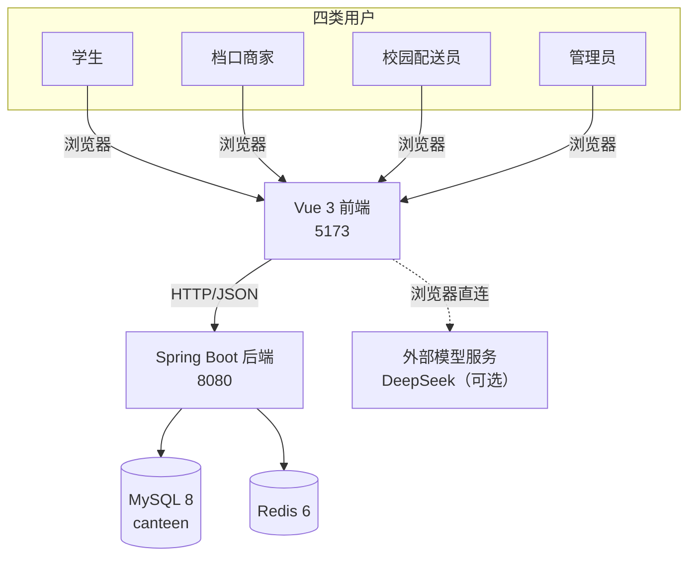
> 描述：四类用户（学生/档口商家/校园配送员/管理员）通过浏览器访问前端；前端经 HTTP/JSON 调用后端；后端连接 MySQL 与 Redis；AI 助手在浏览器端直连外部模型服务。
> Mermaid 源码见附录 B。

### 2.2 逻辑架构

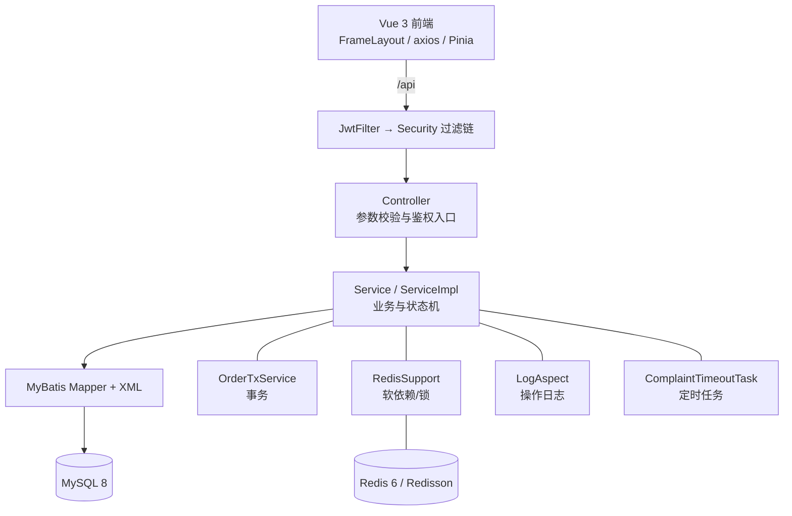
> 描述：Vue 3 前端 → axios → JwtFilter → Controller → Service → MyBatis Mapper → MySQL；横切组件 OrderTxService（事务）、RedisSupport（软依赖）、LogAspect（操作日志）、ComplaintTimeoutTask（定时任务）叠加在 Service 层。
> Mermaid 源码见附录 B。

### 2.3 部署视图

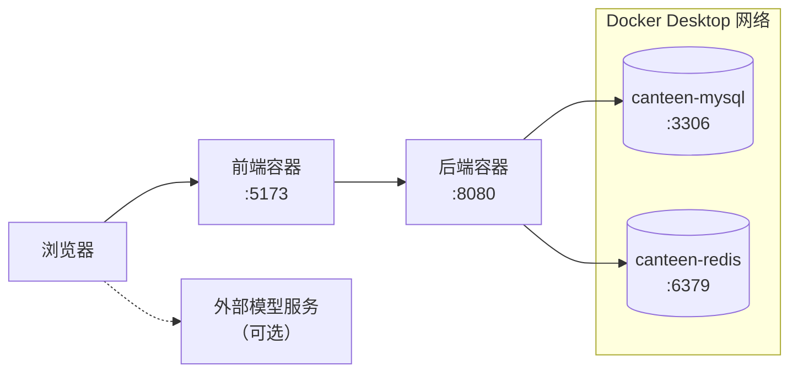
> 描述：浏览器 → 前端 5173 → 后端 8080 → MySQL 3306 / Redis 6379（Docker 网络内）；AI 助手经浏览器直连外部模型服务（可选）。
> Mermaid 源码见附录 B。

### 2.4 技术选型与理由

| 要求 | 选型 | 理由 / 落地位置 |
|---|---|---|
| 前后端分离 | Vue 3 + Vite 5 / Spring Boot 2.7.18 | 独立工程、REST + JSON、Vite 代理解决跨域 |
| Vue 框架 | Vue Router 4 + Pinia + Element Plus | 四角色布局路由、登录态与角色状态、统一组件风格 |
| Spring Boot | 2.7.18 + Java 11/17 | 与课程环境匹配；Lombok 注解处理器显式配置兼容高版本 JDK（R-08） |
| MyBatis | mybatis-starter + PageHelper | XML 可控 SQL、条件更新、分页列表 |
| Redis | spring-data-redis + Redisson 3.23.5 | 预减库存、ZSet 热销榜、抢单/库存锁；软依赖降级（见 8.2） |
| 日志 | Logback + AOP `@OpLog` | 文件日志 + 结构化落库，满足日志框架与审计要求 |
| Spring Security | Security 5.7 + jjwt 0.11.5 | JWT 无状态、四角色 URL 规则、401/403 统一 JSON |
| RBAC | 五表模型 + RIDER 角色 | 用户-角色-权限映射，鉴权时实时查库 |
| 其他 | knife4j 4.3.0 / qrcode 1.5.4 / ECharts 5 / Hutool | 接口文档 / 二维码 / 报表 / 工具 |

### 2.5 分层职责

- **前端**：`src/layouts/FrameLayout.vue` 为四角色共用壳，通过路由 `meta.roles` 守卫；`src/api/*` 统一封装请求并携带凭证；`src/stores/user.js` 持久化 token/role/portal。
- **后端**：`controller`（参数校验与鉴权入口）→ `service`/`service.impl`（业务与状态机）→ `mapper` + XML（数据访问）。
- **基础设施**：Docker 编排 Redis 6（无密码，仅限本地演示，R-03 关联）与 MySQL 8（root/123456），首次启动自动执行基础脚本；增量脚本按序手动执行（见 9.2）。

---

## 3. 数据设计

### 3.1 表结构总览（基础 16 表 + 补丁 4 表 = 20 表）

`schema.sql` 建 16 表；三个增量补丁依次追加 4 表并补充若干列。全部 InnoDB / utf8mb4，金额一律 `DECIMAL`，**逻辑外键（无物理 FK 约束），一致性由 Service 层事务与校验保证**。

**图 4-1 RBAC 域 ER 图**
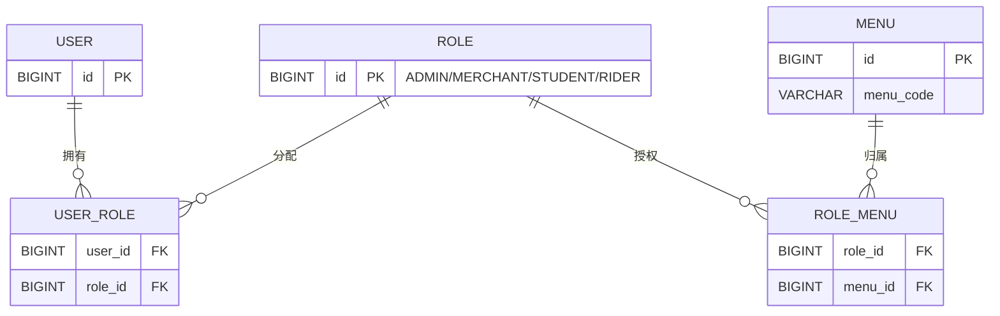

**图 4-2 食堂域 ER 图**
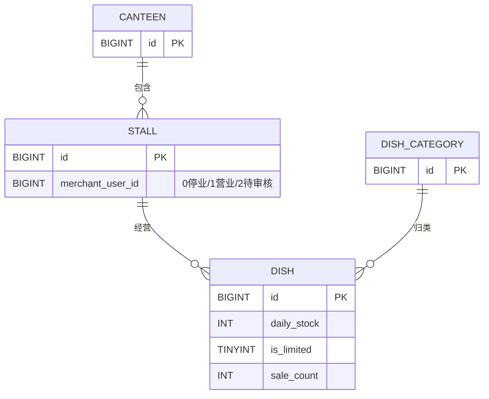

**图 4-3 交易域 ER 图**
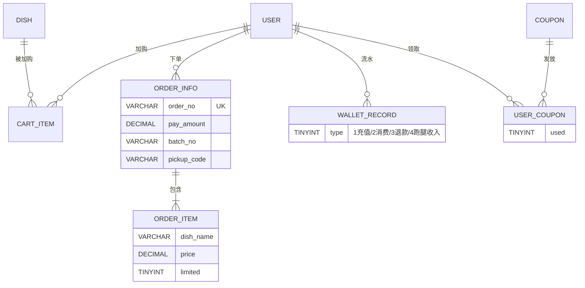

**图 4-4 反馈与系统域 ER 图**
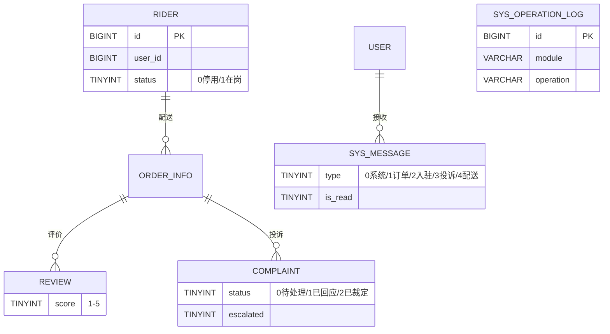

### 3.2 字段级数据字典（核心表完整，其余表列出关键字段）

#### 3.2.1 user 用户表

| 字段 | 类型 | 可空 | 默认值 | 说明 |
|---|---|---|---|---|
| id | BIGINT PK AI | 否 | — | 用户 ID |
| username | VARCHAR(50) UNIQUE | 否 | — | 登录账号 |
| password | VARCHAR(100) | 否 | — | 密码（BCrypt 密文） |
| nickname | VARCHAR(50) | 是 | — | 昵称 |
| phone | VARCHAR(20) | 是 | — | 手机号 |
| avatar | VARCHAR(255) | 是 | — | 头像 URL |
| balance | DECIMAL(10,2) | 否 | 0 | 钱包余额 |
| status | TINYINT | 否 | 1 | 0 禁用 / 1 正常 |
| create_time / update_time | DATETIME | 是 | CURRENT_TIMESTAMP | 创建/更新时间 |

#### 3.2.2 dish 菜品表

| 字段 | 类型 | 可空 | 默认值 | 说明 |
|---|---|---|---|---|
| id | BIGINT PK AI | 否 | — | 菜品 ID |
| stall_id | BIGINT | 否 | — | 所属档口（逻辑外键） |
| category_id | BIGINT | 否 | — | 分类 |
| name | VARCHAR(50) | 否 | — | 菜品名称 |
| description | VARCHAR(255) | 是 | — | 描述 |
| price | DECIMAL(8,2) | 否 | — | 价格 |
| image | VARCHAR(255) | 是 | — | 图片 URL |
| daily_stock | INT | 否 | 0 | 每日剩余限量数 |
| is_limited | TINYINT | 否 | 0 | 1 限量菜 / 0 不限量（区分卖完与不限量，R-06 关联注释） |
| sale_count | INT | 否 | 0 | 累计销量（热销榜/报表数据源） |
| status | TINYINT | 否 | 1 | 0 下架 / 1 上架 |
| create_time / update_time | DATETIME | 是 | CURRENT_TIMESTAMP | 创建/更新时间 |

#### 3.2.3 order_info 订单主表

| 字段 | 类型 | 可空 | 默认值 | 说明 |
|---|---|---|---|---|
| id | BIGINT PK AI | 否 | — | 订单 ID |
| order_no | VARCHAR(32) UNIQUE | 否 | — | 订单号 |
| user_id / stall_id | BIGINT | 否 | — | 下单用户 / 档口 |
| total_amount | DECIMAL(10,2) | 否 | — | 总金额 |
| discount_amount | DECIMAL(10,2) | 否 | 0 | 优惠金额 |
| pay_amount | DECIMAL(10,2) | 否 | — | 实付金额（含跑腿费） |
| delivery_fee | DECIMAL(8,2) | 否 | 0.00 | 跑腿费（担保交易，送达后结算） |
| user_coupon_id | BIGINT | 是 | NULL | 核销的领券记录 ID（精确退券） |
| batch_no | VARCHAR(64) | 是 | NULL | 批量下单批次号 |
| pickup_code | VARCHAR(8) | 是 | NULL | 取餐码（自取单；配送单为 NULL） |
| delivery_type | TINYINT | 否 | 0 | 0 自取 / 1 配送（补丁列） |
| rider_id | BIGINT | 是 | NULL | 配送员 ID（补丁列） |
| delivery_status | TINYINT | 是 | NULL | 0 未分配 / 1 配送中 / 2 已送达（补丁列） |
| delivery_location | VARCHAR(100) | 是 | NULL | 校内送达地点（补丁列） |
| status | TINYINT | 否 | 0 | 0 待处理 / 1 已完成 / 2 已取消 |
| create_time / update_time | DATETIME | 是 | CURRENT_TIMESTAMP | 创建/更新时间 |

**索引**：`idx_user(user_id)`、`idx_stall_status(stall_id,status)`。

#### 3.2.4 order_item 订单明细表

| 字段 | 类型 | 可空 | 默认值 | 说明 |
|---|---|---|---|---|
| id | BIGINT PK AI | 否 | — | 明细 ID |
| order_id / dish_id | BIGINT | 否 | — | 订单 / 菜品 |
| dish_name | VARCHAR(50) | 否 | — | 菜名快照 |
| price | DECIMAL(8,2) | 否 | — | 价格快照 |
| quantity | INT | 否 | 1 | 数量 |
| limited | TINYINT | 否 | 0 | 下单时是否限量菜（决定退款是否补库存，补丁列） |

#### 3.2.5 wallet_record 钱包流水表

| 字段 | 类型 | 可空 | 默认值 | 说明 |
|---|---|---|---|---|
| id | BIGINT PK AI | 否 | — | 流水 ID |
| user_id | BIGINT | 否 | — | 用户 |
| type | TINYINT | 否 | — | 1 充值 / 2 消费 / 3 退款 / 4 跑腿收入（数据库注释仍写 1–3，R-06） |
| amount | DECIMAL(10,2) | 否 | — | 金额 |
| ref_order_no | VARCHAR(32) | 是 | NULL | 关联订单号 |
| create_time | DATETIME | 是 | CURRENT_TIMESTAMP | 创建时间 |

#### 3.2.6 complaint 投诉工单表（补丁表）

| 字段 | 类型 | 可空 | 默认值 | 说明 |
|---|---|---|---|---|
| id | BIGINT PK AI | 否 | — | 工单 ID |
| order_id / user_id / stall_id | BIGINT | 否 | — | 关联订单/发起人/档口 |
| type | TINYINT | 否 | — | 1 质量 / 2 漏发 / 3 配送 / 4 态度 |
| content | VARCHAR(255) | 否 | — | 投诉内容 |
| status | TINYINT | 否 | 0 | 0 待处理 / 1 已回应 / 2 已裁定 |
| reply / verdict / result | — | 是 | NULL | 商家回应 / 裁定说明 / 1 成立 0 不成立 |
| refund_amount | DECIMAL(10,2) | 是 | NULL | 退款金额 |
| escalated | TINYINT | 否 | 0 | 是否已超时升级（补丁列） |
| create_time | DATETIME | 是 | CURRENT_TIMESTAMP | 创建时间 |

#### 3.2.7 其余表关键字段

| 表 | 关键字段 |
|---|---|
| role / user_role / menu / role_menu | role_code 唯一；user_role 与 role_menu 各有唯一键；menu_code 唯一 |
| canteen / stall | stall.status 0 停业/1 营业/2 待审核；merchant_user_id 数据权限依据 |
| dish_category | name、sort |
| cart_item | uk_user_dish(user_id,dish_id) 唯一，重复加购走更新数量 |
| coupon / user_coupon | threshold/amount/stock/expire_time；user_coupon.used 0/1 |
| review | order_id + dish_id 维度，score 1–5 |
| rider | user_id、name、phone、status 0 停用/1 在岗 |
| sys_message | type 0 系统/1 订单/2 入驻/3 投诉/4 配送；is_read |
| sys_operation_log | 操作人/模块/操作/方法/参数(截断)/耗时/成败/错误 |

### 3.3 枚举字典

| 枚举 | 字段 | 码值 |
|---|---|---|
| 用户状态 | user.status | 0 禁用 / 1 正常 |
| 档口状态 | stall.status | 0 停业 / 1 营业 / 2 待审核 |
| 菜品上下架 | dish.status | 0 下架 / 1 上架 |
| 限量标记 | dish.is_limited | 0 不限量 / 1 限量 |
| 订单状态 | order_info.status | 0 待处理 / 1 已完成 / 2 已取消 |
| 就餐方式 | order_info.delivery_type | 0 自取 / 1 配送 |
| 配送状态 | order_info.delivery_status | 0 未分配 / 1 配送中 / 2 已送达 |
| 流水类型 | wallet_record.type | 1 充值 / 2 消费 / 3 退款 / 4 跑腿收入（R-06） |
| 券状态 | coupon.status | 0 停发 / 1 发放中 |
| 领券状态 | user_coupon.used | 0 未使用 / 1 已使用 |
| 投诉状态 | complaint.status | 0 待处理 / 1 已回应 / 2 已裁定 |
| 投诉结果 | complaint.result | 0 不成立 / 1 成立 |
| 投诉类型 | complaint.type | 1 质量 / 2 漏发 / 3 配送 / 4 态度 |
| 消息类型 | sys_message.type | 0 系统 / 1 订单 / 2 入驻 / 3 投诉 / 4 配送 |
| 配送员状态 | rider.status | 0 停用 / 1 在岗 |

---

## 4. 核心流程设计

### 4.1 限量菜并发保护（FR-STU-06 / NFR-C1）

> 实测证据：初始库存 30、并发 50 的压测结果为成功 30、失败（售罄）20、库存终值 0，详见《防超卖压测报告 v1.0》。

**图 5-1 限量菜并发下单时序图**
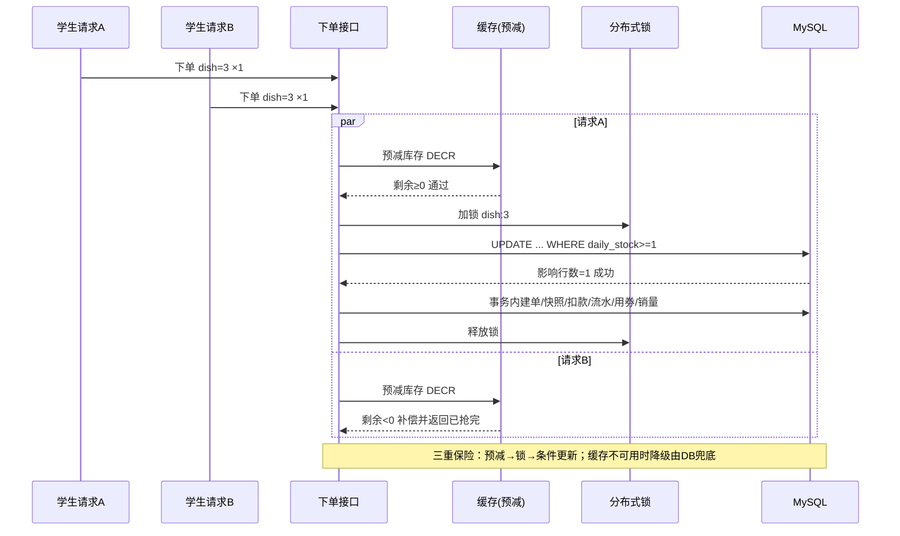

**三重保险**：① 缓存原子预减（不足则补偿返回售罄）；② 分布式锁（按菜品维度）；③ 数据库条件更新（影响行数为 0 回滚）。失败时补偿预减、事务回滚。

### 4.2 跨档口原子批量下单（FR-STU-05 / NFR-D1）

**图 5-2 跨档口批量下单时序图**
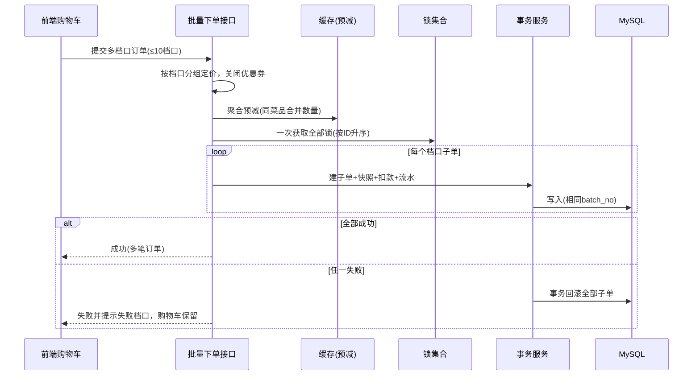

### 4.3 退款全量副作用回滚（FR-STU-09 / FR-ADM-06 / NFR-D3）

**图 5-3 退款全量回滚时序图**
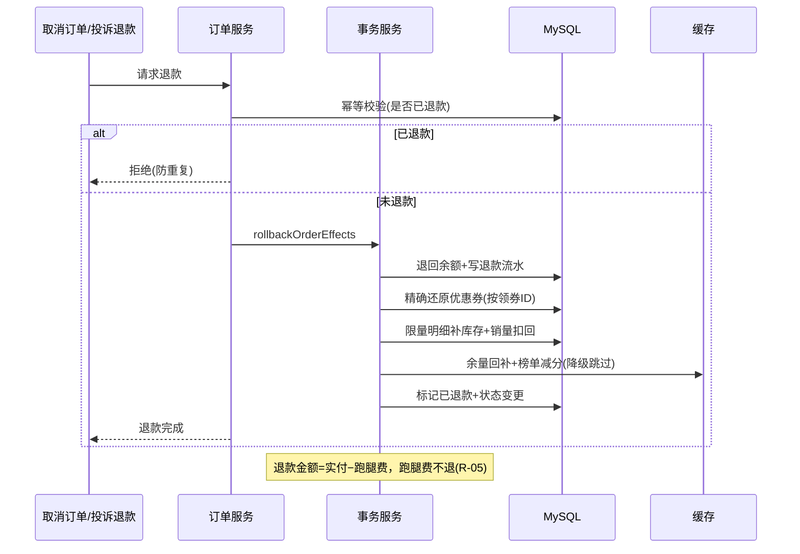

| 副作用 | 回滚方式 |
|---|---|
| 余额 | 退回实付金额 + 写退款流水 |
| 优惠券 | 按订单记录的领券 ID 精确还原 |
| 库存 | 仅下单时限量菜的明细补库存并回补缓存 |
| 销量 | 所有明细扣回销量 |
| 热销榜 | 缓存榜单减分（降级跳过） |
| 防重复 | 退款前标记已退款，条件更新影响行数为 0 即拒绝 |

### 4.4 校内配送担保交易与抢单（FR-RID / NFR-C2）

**图 5-4 抢单时序图**
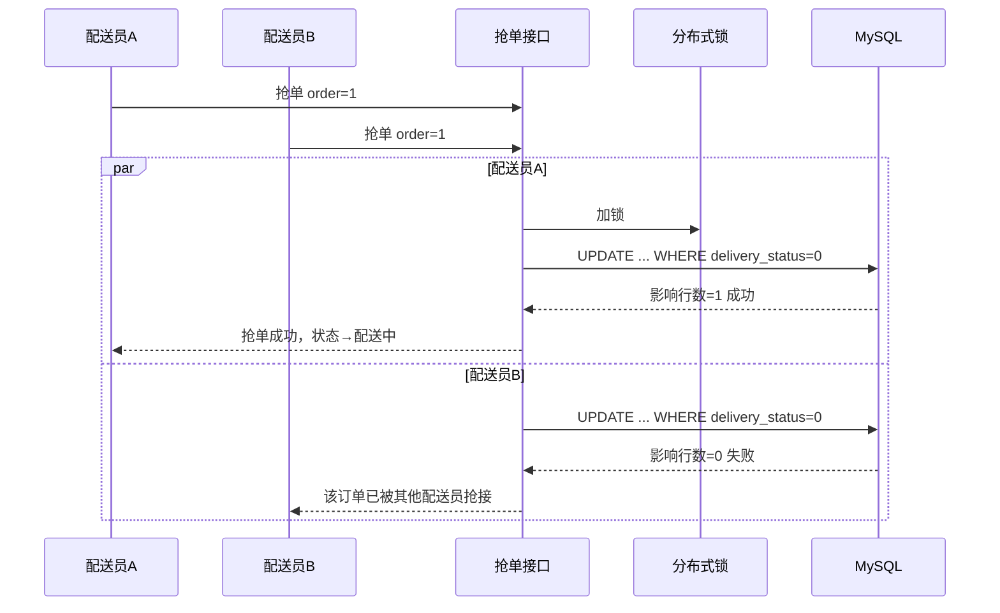

学生下单（配送方式、送达地点、2 元跑腿费、无取餐码）→ 配送员抢单 → 标记送达结算跑腿费（流水类型 4）→ 通知学生。管理员可兜底指派/送达（不结算跑腿费，R-05）。

### 4.5 投诉闭环与超时升级（FR-ADM-06/07）

**图 5-5 投诉超时升级时序图**
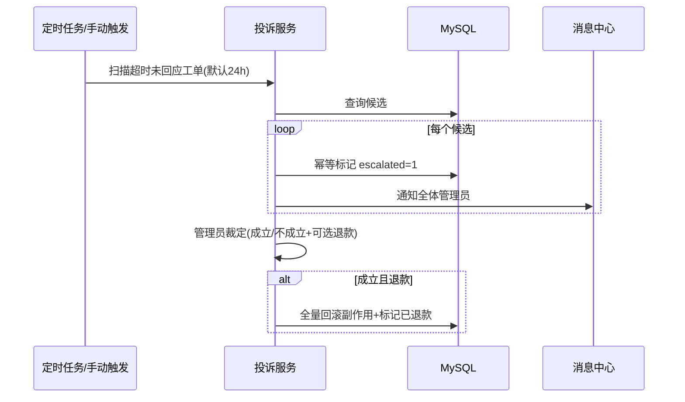

### 4.6 操作日志切面（FR-ALL-09 / R-09）

**图 5-6 AOP 操作日志时序图**
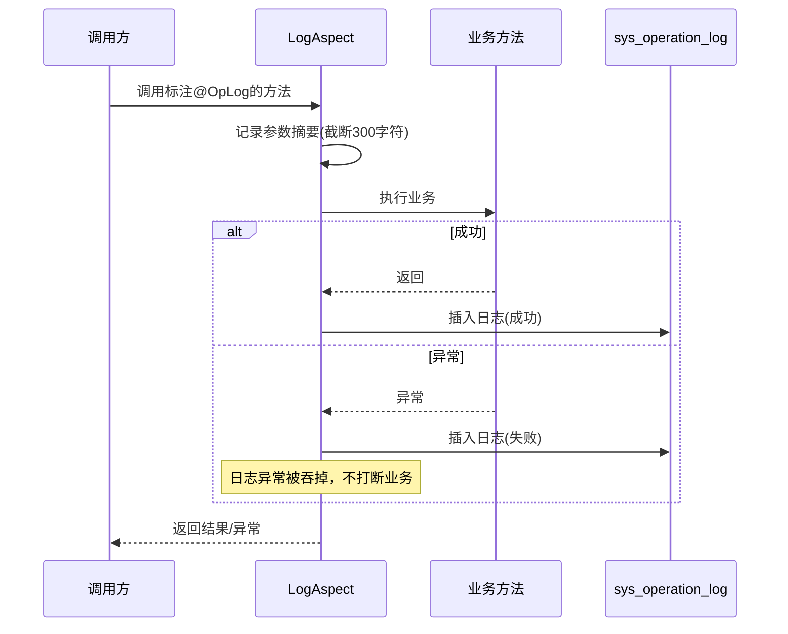

### 4.7 AI 助手（FR-AI / R-03）

**图 5-7 AI Function Calling 时序图**
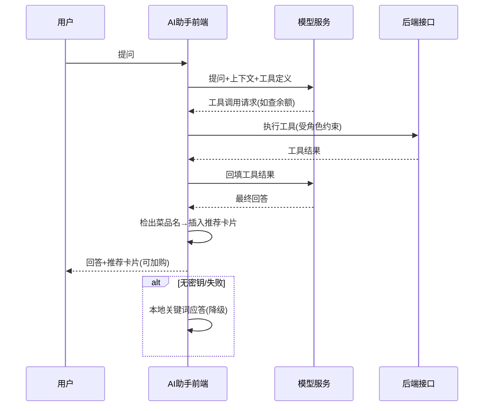

### 4.8 二维码核销与语音播报（FR-STU-10 / FR-MER-04）

**图 5-8 二维码核销时序图**
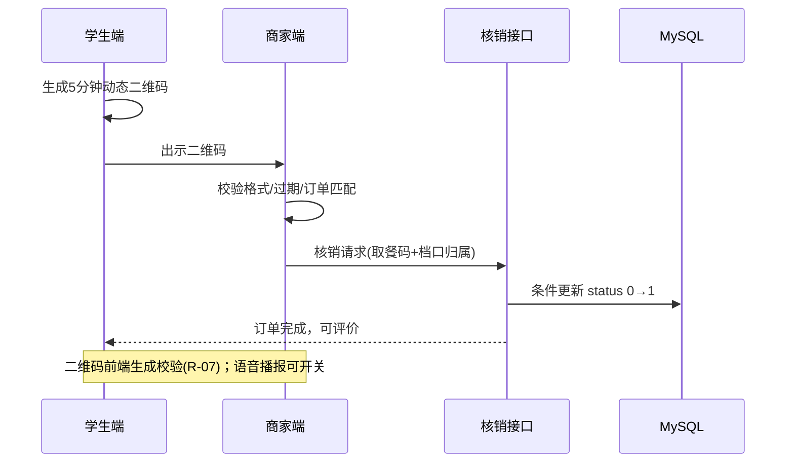

### 4.9 缓存降级策略（NFR-A1 / R-04）

`RedisSupport` 构造时尝试连接，失败则客户端置空并记录警告；锁降级为直接执行；预减降级放行由数据库条件更新兜底；热销榜降级为数据库排序。**当前仅在启动时探测一次，恢复后需重启后端**（R-04）。

---

## 5. 状态机设计

**图 5-9 订单状态机**
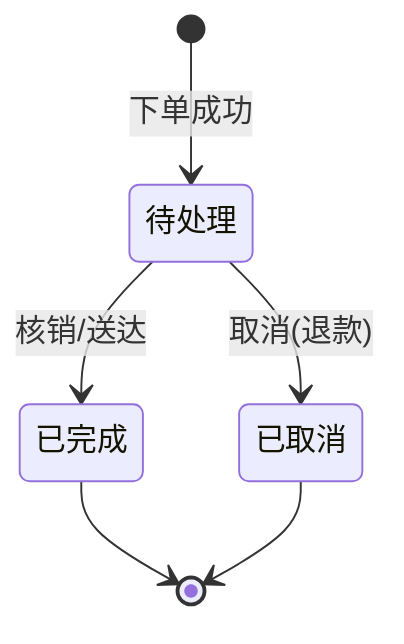

**图 5-10 配送状态机**
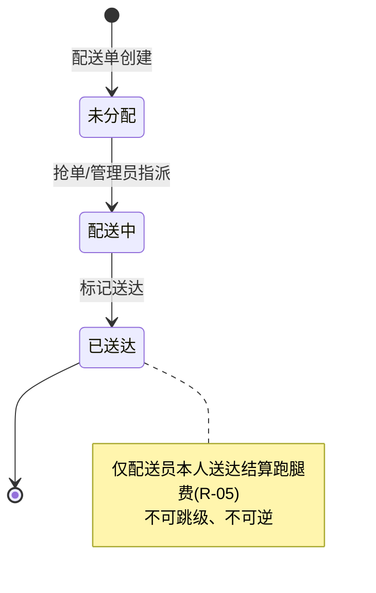

**图 5-11 投诉状态机**
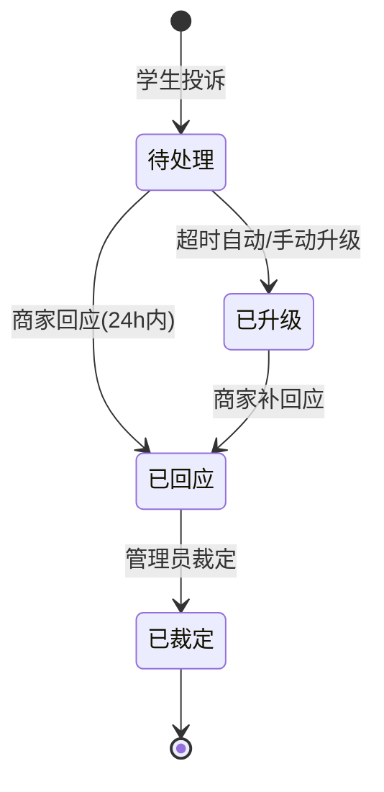

**图 5-12 档口状态机**
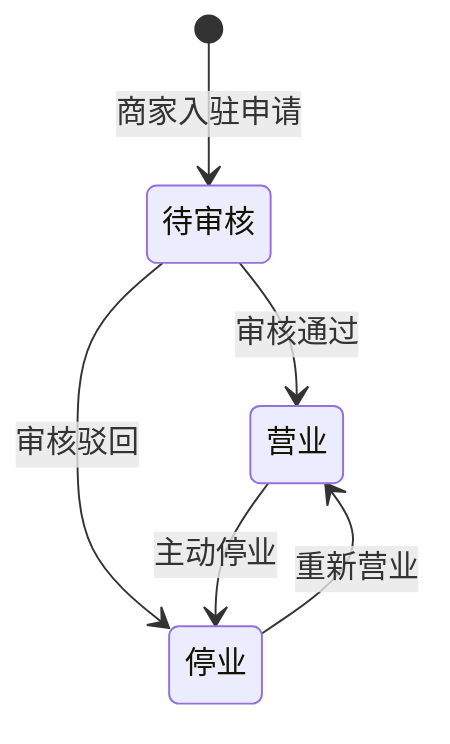

---

## 6. 接口设计

### 6.1 接口约定

- REST 风格；统一返回体 `{code:200, message, data}`，分页为 `PageResult{list,total,pageNum,pageSize}`。
- 错误码：400 参数/状态非法、401 未登录、403 无权限、500 系统异常（业务子码见附录 A）。
- 参数校验：声明式校验（非空/范围/长度）；前端统一处理错误弹窗与 401 登出。

### 6.2 接口清单（按端分组）

> 完整字段级契约以在线接口文档（knife4j `/doc.html`）为准；此处列代表接口与权限要求。

| 端 | 代表接口 | 权限 |
|---|---|---|
| 公共 | 登录、注册、商家入驻申请、食堂列表、健康检查、接口文档 | 放行或登录即可 |
| 学生 | 菜品分页/热销榜、购物车增删改、下单/批量下单/取消、钱包/券、评价/投诉、消息 | 登录即可 + 归属校验 |
| 商家 | 本档口菜品管理、订单看板与核销、销量统计、投诉回应 | 商家角色 + 本档口校验 |
| 配送员 | 待接单列表、我的配送、抢单、标记送达 | 配送员角色 + 本人校验 |
| 管理 | 用户管理、档口审核、配送调度、投诉裁定/升级、券投放、日志查询/清空、统计 | 管理员角色 |

### 6.3 接口契约附录

本节给出系统全部 74 个 REST 接口的完整契约（按 Swagger 分组导出路径、方法、入参、出参），详见文末「附录 C 完整接口契约」。所有接口统一返回 `Result{code,message,data}`，分页接口返回 `PageResult{list,total,pageNum,pageSize}`；错误码见附录 A。

---

## 7. 安全设计

### 7.1 认证

- 凭证：JWT（HS256），有效期 24 小时；签发载荷含用户标识、账号、角色。
- 密码：单向加密存储（BCrypt），库中零明文。

### 7.2 授权

- URL 级：放行登录/注册/入驻/食堂列表/健康/文档；管理端仅管理员、商家端仅档口商家、配送端仅配送员，其余登录即可。
- 鉴权时从数据库实时加载角色与状态，凭证中的角色仅作兜底；禁用账号与角色变更即时生效。
- 401（未登录）与 403（无权限）统一返回结构化 JSON。

### 7.3 数据权限

- 商家按 `stall.merchant_user_id` 校验本档口；配送员按 `order.rider_id` 校验本人订单；学生按 `order.user_id` 校验本人订单。
- 数据权限在业务层手动校验，不依赖框架自动完成（见 SRS 4.2 权限矩阵的数据范围列）。

### 7.4 敏感配置与日志

- 敏感配置：AI 密钥为前端本地可选配置（R-03），生产环境须后端代理；缓存服务无密码仅限本地演示环境。
- 日志：操作日志参数截断 300 字符，当前未做字段级脱敏（R-06）；敏感字段不进入日志。

### 7.5 已知风险

R-01~R-09 见第 10 节；本节关联 R-03（敏感配置）、R-06（脱敏）、R-07（二维码无服务端验签）。

---

## 8. 横切核心组件

| 组件 | 职责 | 调用方 | 失败策略 / 降级行为 |
|---|---|---|---|
| OrderTxService | 订单事务（建单/快照/扣款/流水/用券/回滚） | 订单服务 | 事务回滚；退款幂等校验 |
| RedisSupport | 缓存服务软依赖封装 | 库存/榜单/锁 | 不可用则客户端置空，增强能力降级（R-04） |
| RedisStockService | 库存预减/回补 | 订单服务 | 不可用时直接放行，由数据库条件更新兜底 |
| LogAspect | 操作日志切面 | 全控制器 | 日志异常吞掉，不影响业务（R-06） |
| ComplaintTimeoutTask | 投诉超时扫描 | 定时调度 | 扫描异常记录警告，不中断任务 |

---

## 9. 部署与配置

### 9.1 启动顺序

Docker 起 MySQL/Redis → 首次自动建库并执行基础脚本 → 按序执行 3 个增量补丁（仅首次）→ 启动后端 → 启动前端。

### 9.2 增量脚本执行顺序（R-02）

| 顺序 | 脚本 | 幂等性 | 重复执行后果 |
|---|---|---|---|
| 1 | `patch_message_complaint.sql` | 可重复 | — |
| 2 | `patch_rider.sql` | **一次性** | 重复执行报列重复错误 |
| 3 | `patch_enhancements.sql` | 可重复 | — |

> 增量脚本后续应合并进基础脚本并加幂等保护（R-02）。

### 9.3 配置项表（含敏感标注）

| 配置项 | 位置 | 默认值 | 敏感 | 生产建议 | 缺失时行为 |
|---|---|---|---|---|---|
| 服务端口 / DB / 缓存 | `application.yml` | 8080 / root:123456@localhost:3306 / 6379 | 密码敏感 | 改强密码并外置 | 启动失败 |
| JWT 密钥与有效期 | `application.yml` | 本地约定值 / 24h | 敏感 | 外置并轮换 | 启动失败 |
| 投诉升级阈值 | `application.yml` | 24 小时 | 否 | 按业务调整 | 用默认值 24 |
| AI 密钥 | 前端 `.env.local` | 空 | **敏感** | 后端代理托管（R-03） | 本地关键词应答 |
| 容器编排 | `docker-compose.yml` | MySQL 3306 / Redis 6379 | 否 | 加密码与网络隔离 | — |

---

## 10. 设计决策与风险登记册

| 编号 | 风险 / 决策 | 影响 | 概率 | 处置 | 状态 |
|---|---|---|---|---|---|
| R-01 | 接口限流未实现 | 高频刷接口无保护 | 中 | 保留扩展点，后续加切面 | 已登记 |
| R-02 | 增量脚本非幂等 | 重复执行报错 | 中 | 明确顺序与后果，后续合并入基础脚本 | 已登记 |
| R-03 | 敏感配置暴露（缓存服务无密码、AI 密钥前端直连） | 配置/密钥泄露风险 | 中 | 仅限本地教学演示环境；生产须启用密码与后端代理 | 已登记 |
| R-04 | 缓存仅启动时探测一次 | 恢复后需重启 | 中 | 文档明确；后续加健康检查 | 已登记 |
| R-05 | 管理端送达不结算跑腿费 | 收入口径 | 低 | 设计如此，如需代结算须新增规则 | 已登记 |
| R-06 | 操作日志无字段级脱敏、钱包流水类型注释不一致 | 日志隐私/字典不一致 | 低 | 截断 300 字符；后续补脱敏与注释 | 已登记 |
| R-07 | 二维码前端生成与校验 | 无服务端验签 | 低 | 教学场景可接受；生产须后端签发一次性票据 | 已登记 |
| R-08 | JDK 版本口径不统一 | 高版本需注解处理器 | 中 | 统一 Java 11/17，保留兼容配置 | 已登记 |
| R-09 | 操作日志敏感字段脱敏未实现 | 密码/凭证可能进入日志参数摘要 | 中 | 当前仅做 300 字符截断；后续增加字段级脱敏 | 已登记 |

**关键设计决策**：
1. 快照：订单明细保存下单时菜名与价格，避免菜品改价影响历史订单；限量标记快照决定退款是否补库存。
2. 精确退券：订单记录领券 ID，退款精确还原。
3. 配送单无取餐码：配送状态机与自取核销线解耦。
4. 跑腿费担保：下单冻结、送达结算，投诉退款只退菜品金额。
5. 无物理外键：便于补丁式加表，一致性由事务与校验保证。

---

## 附录 A 错误码字典

| 码 | 含义 |
|---|---|
| 400 | 参数或状态非法 |
| 401 | 未登录或凭证无效 |
| 403 | 无权限 |
| 500 | 系统异常 |
| 业务子码 | 库存不足 / 余额不足 / 重复抢单 / 券不可用 / 重复退款（以接口文档为准） |

## 附录 B 图表索引

| 图号 | 名称 |
|---|---|
| 图 3-1 | 系统上下文图 |
| 图 3-2 | 逻辑架构图 |
| 图 3-3 | 部署图 |
| 图 4-1~4-4 | ER 图（四域） |
| 图 5-1 | 限量菜并发下单时序图 |
| 图 5-2 | 跨档口批量下单时序图 |
| 图 5-3 | 退款全量回滚时序图 |
| 图 5-4 | 抢单时序图 |
| 图 5-5 | 投诉超时升级时序图 |
| 图 5-6 | AOP 操作日志时序图 |
| 图 5-7 | AI Function Calling 时序图 |
| 图 5-8 | 二维码核销时序图 |
| 图 5-9~5-12 | 订单/配送/投诉/档口状态机 |

> 图形源文件以 Mermaid 源码形式保留于本文正文，Word 版图片由使用者插入；本文图号与 SRS 图 7-1 相互引用。

---

## 附录 C 完整接口契约

本附录由后端 Controller 的 Swagger 注解自动导出，共 74 个接口、22 个分组。统一返回体为 `Result{code,message,data}`（分页为 `PageResult{list,total,pageNum,pageSize}`），错误码见附录 A。`方法·路径` 列首词为 HTTP 方法，`—` 表示无入参。

### C.1 管理端投诉裁定（3 个接口）

| 方法·路径 | 说明 | 入参 | 返回 |
|---|---|---|---|
| GET /api/admin/complaint/list | 全部投诉列表（status: 0待处理 1已回应 2已裁定） | Param status:Integer | `Result<List<Map<String, Object>>>` |
| POST /api/admin/complaint/{id}/escalate | 手动升级超时投诉（演示开关：商家未回应时立即升级给管理员） | Long id | `Result<Void>` |
| POST /api/admin/complaint/{id}/resolve | 裁定投诉 { pass, content, refund(true=全额退款) } | Long id | `Result<Void>` |

### C.2 管理端-用户与档口（5 个接口）

| 方法·路径 | 说明 | 入参 | 返回 |
|---|---|---|---|
| GET /api/admin/user/page | 用户列表（keyword 模糊搜账号/昵称/手机号） | Param keyword:String；Param pageNum:Integer=默认1；Param pageSize:Integer=默认10 | `Result<PageResult<UserAdminVO>>` |
| POST /api/admin/user/{id}/status | 禁用/启用账号（禁用后登录被拒，旧 token 因角色实时查库同样失效） | Long id | `Result<Void>` |
| POST /api/admin/user/{id}/role | 重置用户角色（STUDENT/MERCHANT/RIDER） | Long id | `Result<Void>` |
| GET /api/admin/stall/list | 档口列表（status 0停业 1营业 2待审核，null 全部） | Param status:Integer | `Result<List<StallVO>>` |
| POST /api/admin/stall/{stallId}/audit | 档口审核（pass=true 营业 / false 驳回停业） | Long stallId | `Result<Void>` |

### C.3 管理端-操作日志（2 个接口）

| 方法·路径 | 说明 | 入参 | 返回 |
|---|---|---|---|
| GET /api/admin/logs | 操作日志列表（最近 300 条，支持模块/关键字/成功失败过滤） | Param keyword:String；Param module:String；Param success:Integer | `Result<List<SysOperationLog>>` |
| DELETE /api/admin/logs | 清空操作日志 | — | `Result<Void>` |

### C.4 基础数据（3 个接口）

| 方法·路径 | 说明 | 入参 | 返回 |
|---|---|---|---|
| GET /api/canteen/list | 食堂列表 | — | `Result<List<Canteen>>` |
| GET /api/category/list | 菜品分类列表 | — | `Result<List<DishCategory>>` |
| GET /api/stall/list | 营业中档口（可按食堂过滤；学生端浏览用） | Param canteenId:Long | `Result<List<Stall>>` |

### C.5 购物车（5 个接口）

| 方法·路径 | 说明 | 入参 | 返回 |
|---|---|---|---|
| GET /api/cart | 我的购物车（带菜品/档口信息） | — | `Result<List<CartVO>>` |
| POST /api/cart | 加购（同菜品重复加购累加数量；限量菜超余量被拒） | — | `Result<Void>` |
| PUT /api/cart/{dishId} | 改量（按 dishId） | Long dishId | `Result<Void>` |
| DELETE /api/cart/{itemId} | 删除一条 | Long itemId | `Result<Void>` |
| DELETE /api/cart | 清空购物车 | — | `Result<Void>` |

### C.6 投诉工单（2 个接口）

| 方法·路径 | 说明 | 入参 | 返回 |
|---|---|---|---|
| POST /api/complaint | 学生：发起投诉 { orderId, type(1菜品质量2漏发缺件3配送4服务态度), content } | — | `Result<Void>` |
| GET /api/complaint/mine | 学生：我的投诉列表 | — | `Result<List<Map<String, Object>>>` |

### C.7 优惠券（5 个接口）

| 方法·路径 | 说明 | 入参 | 返回 |
|---|---|---|---|
| GET /api/coupon/issuing | 可领取的券（发放中+有库存+未过期） | — | `Result<List<CouponVO>>` |
| GET /api/coupon/mine | 我的券（含使用状态） | — | `Result<List<CouponVO>>` |
| POST /api/coupon/{couponId}/claim | 领取（属人限量，同一券只领一次） | Long couponId | `Result<Void>` |
| POST /api/admin/coupon | 管理端：投放新券 | — | `Result<Void>` |
| GET /api/admin/coupon/list | 管理端：全部券 | — | `Result<List<Coupon>>` |

### C.8 学生端-菜品（3 个接口）

| 方法·路径 | 说明 | 入参 | 返回 |
|---|---|---|---|
| GET /api/dish/page | 菜品分页（食堂/档口/分类/搜索/销量余量展示） | Param canteenId:Long；Param stallId:Long；Param categoryId:Long；Param keyword:String；Param pageNum:Integer=默认1；Param pageSize:Integer=默认10 | `Result<PageResult<DishVO>>` |
| GET /api/dish/{id} | 菜品详情（含评分聚合） | Long id | `Result<DishVO>` |
| GET /api/dish/hot | 实时热销榜（Redis ZSet；Redis 不可用降级数据库销量排序） | Param limit:Integer=默认10 | `Result<List<SaleRankVO>>` |

### C.9 健康检查（1 个接口）

| 方法·路径 | 说明 | 入参 | 返回 |
|---|---|---|---|
| GET /api/health | 健康检查 | — | `java.util.Map<String, Object>` |

### C.10 商家投诉处理（2 个接口）

| 方法·路径 | 说明 | 入参 | 返回 |
|---|---|---|---|
| GET /api/merchant/complaint/list | 本店投诉列表（status: 0/1/2 可过滤） | Param status:Integer | `Result<List<Map<String, Object>>>` |
| POST /api/merchant/complaint/{id}/reply | 回应投诉 { content } | Long id | `Result<Void>` |

### C.11 商家端-菜品管理（4 个接口）

| 方法·路径 | 说明 | 入参 | 返回 |
|---|---|---|---|
| GET /api/merchant/dish/page | 本档口菜品分页 | Param stallId:Long；Param keyword:String；Param pageNum:Integer=默认1；Param pageSize:Integer=默认10 | `Result<PageResult<DishVO>>` |
| POST /api/merchant/dish/save | 新增/修改菜品（修改传 id；仅本档口） | — | `Result<Void>` |
| PUT /api/merchant/dish/{id}/status/{status} | 上下架（status 0下架 1上架） | Long id；Integer status | `Result<Void>` |
| DELETE /api/merchant/dish/{id} | 删除菜品（仅本档口） | Long id | `Result<Void>` |

### C.12 商家端-出餐看板（2 个接口）

| 方法·路径 | 说明 | 入参 | 返回 |
|---|---|---|---|
| GET /api/merchant/order/page | 本档口订单（status null=全部，0待处理 1已完成 2已取消） | Param status:Integer；Param pageNum:Integer=默认1；Param pageSize:Integer=默认10 | `Result<PageResult<OrderVO>>` |
| POST /api/merchant/order/{orderId}/verify | 核销出餐（按取餐码对应订单；仅自取单） | Long orderId | `Result<Void>` |

### C.13 商家端-档口（2 个接口）

| 方法·路径 | 说明 | 入参 | 返回 |
|---|---|---|---|
| GET /api/merchant/stall/mine | 我的档口 | — | `Result<List<StallVO>>` |
| PUT /api/merchant/stall/{stallId} | 修改档口名称/营业状态（仅本档口；审核中不可改） | Long stallId | `Result<Void>` |

### C.14 站内消息（4 个接口）

| 方法·路径 | 说明 | 入参 | 返回 |
|---|---|---|---|
| GET /api/message/page | 消息分页（isRead 不传=全部，传0=未读） | Param isRead:Integer；Param pageNum:Integer=默认1；Param pageSize:Integer=默认10 | `Result<PageResult<SysMessage>>` |
| GET /api/message/unread-count | 未读数量（顶栏铃铛角标轮询用） | — | `Result<Long>` |
| POST /api/message/{id}/read | 标记单条已读 | Long id | `Result<Void>` |
| POST /api/message/read-all | 全部标记已读 | — | `Result<Void>` |

### C.15 学生端-订单（5 个接口）

| 方法·路径 | 说明 | 入参 | 返回 |
|---|---|---|---|
| POST /api/order | 下单（同一档口单一事务；未传券自动匹配最高可用，配送单可选 deliveryType=1） | — | `Result<OrderCreateVO>` |
| POST /api/order/batch | 跨档口批量下单：一个事务创建全部子单，任一失败全部回滚 | — | `Result<List<OrderCreateVO>>` |
| GET /api/order/page | 我的订单列表（status 0待处理 1已完成 2已取消，null 全部） | Param status:Integer；Param pageNum:Integer=默认1；Param pageSize:Integer=默认10 | `Result<PageResult<OrderVO>>` |
| GET /api/order/{id} | 订单详情（本人） | Long id | `Result<OrderVO>` |
| POST /api/order/{id}/cancel | 取消订单（退回钱包+退回用券） | Long id | `Result<Void>` |

### C.16 权限自检（3 个接口）

| 方法·路径 | 说明 | 入参 | 返回 |
|---|---|---|---|
| GET /api/user/me | 当前登录用户（登录即可访问，前端个人中心用） | — | `Result<LoginUser>` |
| GET /api/admin/ping | ADMIN 专用探针：学生/商家访问应返回 403 | — | `Result<String>` |
| GET /api/merchant/ping | MERCHANT 专用探针：学生/管理员访问应返回 403 | — | `Result<String>` |

### C.17 评价（2 个接口）

| 方法·路径 | 说明 | 入参 | 返回 |
|---|---|---|---|
| POST /api/review | 提交评价（1-5 分 + 文字；同一订单同一菜品一次） | — | `Result<Void>` |
| GET /api/review/order/{orderId} | 订单的评价列表 | Long orderId | `Result<List<Review>>` |

### C.18 校园配送端-接单配送（勤工助学）（5 个接口）

| 方法·路径 | 说明 | 入参 | 返回 |
|---|---|---|---|
| GET /api/rider/me | 当前校园配送员档案 | — | `Result<RiderVO>` |
| GET /api/rider/orders/pending | 抢单大厅：待分配的配送单 | — | `Result<List<OrderVO>>` |
| GET /api/rider/orders/mine | 我接的配送单 | — | `Result<List<OrderVO>>` |
| POST /api/rider/orders/{orderId}/grab | 抢单（并发只有一人成功） | Long orderId | `Result<Void>` |
| POST /api/rider/orders/{orderId}/deliver | 我接的单标记送达 | Long orderId | `Result<Void>` |

### C.19 管理端-校园配送员管理（6 个接口）

| 方法·路径 | 说明 | 入参 | 返回 |
|---|---|---|---|
| GET /api/admin/rider/list | 骑手列表（keyword 模糊搜姓名/手机号/账号） | Param keyword:String；Param pageNum:Integer=默认1；Param pageSize:Integer=默认10 | `Result<PageResult<RiderVO>>` |
| POST /api/admin/rider/create | 新增骑手（创建登录账号并绑定 RIDER 角色，默认在岗） | — | `Result<Void>` |
| PUT /api/admin/rider/{id} | 修改骑手（姓名/手机号/0停用 1在岗；停用即禁登录） | Long id | `Result<Void>` |
| GET /api/admin/rider/pending-orders | 待分配配送单列表（delivery_status=0） | Param pageNum:Integer=默认1；Param pageSize:Integer=默认10 | `Result<PageResult<OrderVO>>` |
| POST /api/admin/rider/assign | 指派骑手（校验在岗；0未分配 -> 1配送中） | — | `Result<Void>` |
| POST /api/admin/rider/{orderId}/deliver | 标记送达（1配送中 -> 2已送达，订单同步已完成） | Long orderId | `Result<Void>` |

### C.20 统计报表（5 个接口）

| 方法·路径 | 说明 | 入参 | 返回 |
|---|---|---|---|
| GET /api/merchant/stats/trend | 商家端：营收/订单量按日趋势（days 默认 7，最大 90） | Param days:Integer=默认7 | `Result<List<DailyStatVO>>` |
| GET /api/merchant/stats/top-dishes | 商家端：菜品销量排行 | Param days:Integer=默认7；Param limit:Integer=默认10 | `Result<List<DishStatVO>>` |
| GET /api/admin/stats/overview | 管理端：全局总览（GMV/订单/用户/营业档口/今日） | — | `Result<OverviewVO>` |
| GET /api/admin/stats/stall-ranking | 管理端：档口营收排行 | — | `Result<List<StallStatVO>>` |
| GET /api/admin/stats/trend | 管理端：全局每日趋势 | Param days:Integer=默认7 | `Result<List<DailyStatVO>>` |

### C.21 用户认证（3 个接口）

| 方法·路径 | 说明 | 入参 | 返回 |
|---|---|---|---|
| POST /api/user/register | 注册（默认 STUDENT 角色，成功即自动登录） | — | `Result<LoginResponse>` |
| POST /api/user/register-merchant | 商家入驻注册（注册账号 + 待审核档口申请，成功即自动登录） | — | `Result<LoginResponse>` |
| POST /api/user/login | 登录（返回 JWT token 与角色） | — | `Result<LoginResponse>` |

### C.22 钱包（2 个接口）

| 方法·路径 | 说明 | 入参 | 返回 |
|---|---|---|---|
| GET /api/wallet | 我的钱包（余额+流水分页） | Param pageNum:Integer=默认1；Param pageSize:Integer=默认10 | `Result<WalletVO>` |
| POST /api/wallet/recharge | 充值（模拟钱包） | — | `Result<Void>` |

---

> 本文档为 SDD v1.1，配套 SRS v1.1 与操作手册 v1.1，基线 `f53f9d1`。风险统一引用 R-01~R-09，术语以 SRS 附录 A 为准。

