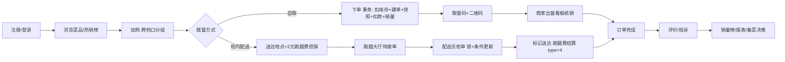

# 智慧校园食堂点餐系统 · 软件需求规格说明书（SRS）

| 项目 | 内容 |
|---|---|
| 文档版本 | v1.0（定稿，已按 `main` 分支提交 `f53f9d1` 逐项核对） |
| 编写日期 | 2026-11-18 |
| 编写依据 | 当前实现代码、`sql/*.sql`、`frontend/src/`、`backend/src/`、README |
| 说明 | 本文所有 FR 状态均以实际可运行代码为准，已交付项统一标记 ✅ |

## 目录

1. [引言](#1-引言)
2. [项目背景与目标](#2-项目背景与目标)
3. [约束条件与技术要求落地情况](#3-约束条件与技术要求落地情况)
4. [用户角色与权限矩阵](#4-用户角色与权限矩阵)
5. [功能需求](#5-功能需求)
6. [典型用例](#6-典型用例)
7. [业务闭环流程](#7-业务闭环流程)
8. [非功能需求](#8-非功能需求)
9. [数据需求](#9-数据需求)
10. [范围边界](#10-范围边界)
11. [可行性分析](#11-可行性分析)
12. [需求—实现追踪表](#12-需求实现追踪表)
13. [验收标准与交付状态](#13-验收标准与交付状态)
14. [遗留问题与后续演进](#14-遗留问题与后续演进)

---

## 1. 引言

### 1.1 编写目的

明确系统要解决的问题、服务对象、必须实现的功能与质量标准，作为设计、开发、测试与答辩验收的统一基线。主线为 **需求 → 实现 → 验证**，每一条需求在第 12 节均可定位到具体实现位置。

### 1.2 读者对象

- 小组成员（开发与联调依据）
- 任课教师与答辩评委（功能与技术评分依据）
- 后续维护者（回归验收基线）

### 1.3 术语表

| 术语 | 定义 |
|---|---|
| 档口 | 食堂内独立经营的餐饮档口，对应一个商家账号 |
| 限量菜 | `is_limited=1` 且 `daily_stock>0` 的菜品；售完即不可下单，是防超卖演示核心 |
| 取餐码 | 自取单下单成功后生成的 4 位数字（1000–9999），当日同档口内唯一；配送单无取餐码 |
| 核销 | 商家按取餐码确认出餐，订单状态 0→1（扫码或手工输入均可） |
| 校园配送 | 勤工助学场景下的校内配送：学生填送达地点并付 2 元跑腿费，配送员抢单送达后结算 |
| 跑腿费担保交易 | 下单时跑腿费冻结在平台，配送员确认送达后才结算到其钱包（`wallet_record.type=4`） |
| 抢单锁 | Redisson 分布式锁 `lock:delivery:grab:{orderId}` + 数据库条件更新，保证一单只被一人抢到 |
| 原子拆单 | 跨档口购物车在一次事务内生成多笔子订单，全部成功或全部回滚（批次号 `batch_no`） |
| 降级模式 | Redis 不可用时自动切换：主流程照常，增强能力退化为纯数据库实现 |
| RBAC | 基于角色的访问控制；四角色 STUDENT / MERCHANT / RIDER / ADMIN |

---

## 2. 项目背景与目标

### 2.1 背景与痛点

| # | 痛点 | 现状 | 系统化解方案 |
|---|---|---|---|
| P1 | 排队时间长 | 午餐高峰现场排队 10–20 分钟 | 线上提前点餐 + 取餐码，到店即取 |
| P2 | 限量菜信息不透明且易超卖 | 到档口才知道卖完；瞬时抢购无保护会超卖 | 实时余量展示 + Redis 预减库存 + 分布式锁 + 数据库条件更新三重防超卖 |
| P3 | 商家经营无数据 | 凭感觉备菜，损耗与缺货并存 | 销量统计 + ECharts 报表 + Redis 实时热销榜 |
| P4 | 校内配送无闭环 | 学生带餐回寝室需求无正规渠道 | 校园配送（勤工助学）：送达地点 + 跑腿费担保交易 + 跑腿大厅抢单 |

### 2.2 项目目标

1. 学生完成 浏览→加购→下单→取餐/送达→评价 完整闭环；
2. 高峰期限量菜抢购零超卖，跨档口下单原子一致；
3. 校内配送可抢单、可追踪、费用安全结算；
4. 四角色权限隔离，关键操作全程留痕可审计；
5. Redis 挂掉时主流程仍完整可用。

### 2.3 已交付亮点技术（答辩演示清单）

| # | 亮点 | 技术构成 | 入口 |
|---|---|---|---|
| H1 | 三重防超卖 | Redis `RAtomicLong` 预减 → Redisson 菜品锁 → MySQL `WHERE daily_stock>0` 条件更新 | 限量菜并发下单 |
| H2 | 实时热销榜 | Redis ZSet `rank:sale`（`incrementScore`/`reverseRange`），DB `sale_count` 兜底 | 学生首页 / 管理端总览 |
| H3 | 跨档口原子下单 | 单事务批量拆单 + `batch_no` + 统一锁集合 | 购物车多档口结算 |
| H4 | 退款全量回滚 | 余额 + 精确退券 + 库存 + 销量 + Redis 余量/榜单 | 取消订单 / 投诉成立退款 |
| H5 | 校园配送担保交易 | 2 元跑腿费冻结 + 送达结算 (`type=4`) + 抢单锁 | 跑腿大厅 / 配送调度 |
| H6 | 投诉超时升级 | 定时扫描 24h 未回应工单 + 手动升级 + 站内消息 | 商家投诉 / 管理端裁定 |
| H7 | AOP 操作日志落库 | `@OpLog` + 环绕通知 + `sys_operation_log` + 管理端查询 | 管理端「操作日志」 |
| H8 | AI Function Calling | DeepSeek `deepseek-chat` + 5 个工具函数 + 两轮调用 + 本地兜底 | 学生端悬浮助手「胆子肥嘟嘟」 |
| H9 | 二维码核销 + 语音播报 | 前端 qrcode 生成 5 分钟动态码；商家 Web Speech API 播报新订单 | 学生订单 / 商家出餐看板 |
| H10 | RBAC 四角色 + 优雅降级 | Spring Security URL 规则 + JWT 实时查库 + Redis 软依赖 | 全系统 |

> 早期规划的「接口限流 RRateLimiter」**未实现**，已从交付亮点中移除（见第 14 节）。

---

## 3. 约束条件与技术要求落地情况

| # | 课程要求 | 本组选型 | 实现证据 | 状态 |
|---|---|---|---|---|
| R-1 | 前后端分离 | Vue 3 + Vite 5 / Spring Boot 2.7.18 | `frontend/src`、`backend/src`，axios 统一走 `/api` 代理 | ✅ |
| R-2 | Vue 前端框架 | Vue Router + Pinia + Element Plus | 四角色布局路由 + 守卫 + localStorage 登录态 | ✅ |
| R-3 | Spring Boot 后端 | 2.7.18，Java 11 | 统一返回体 / 全局异常 / 分层结构 | ✅ |
| R-4 | MyBatis 数据访问 | mybatis-starter 2.3.1 + PageHelper 1.4.7 | 18 个 Mapper + XML，下划线转驼峰 | ✅ |
| R-5 | Redis 缓存 | spring-data-redis + Redisson 3.23.5 | `RedisSupport` 软依赖封装；预减库存/ZSet/抢单锁 | ✅ |
| R-6 | slf4j 日志 | Logback 按天滚动 + AOP 落库 | `logs/canteen.log` + `sys_operation_log` | ✅ |
| R-7 | Spring Security | Security 5.7 + JWT (jjwt 0.11.5) | JWT 过滤器 + 四角色路径鉴权，401/403 | ✅ |
| R-8 | RBAC 设计 | user/role/user_role/menu/role_menu 五表 + RIDER 角色 | 建表 + 数据 + 鉴权规则 | ✅ |
| R-9 | 重点业务 + 亮点 | 点餐防超卖为核心；H1–H10 已落地 | 见第 5、12 节 | ✅ |

> 环境约束：JDK 11/17 运行（JDK 20+ 不受支持）；Redis 与 MySQL 统一 Docker（见两篇环境文档）；`VITE_DEEPSEEK_API_KEY` 为可选本地配置，缺失不影响主流程。

---

## 4. 用户角色与权限矩阵

### 4.1 角色画像

| 角色 | 编码 | 使用动机 | 高频场景 | 登录端 |
|---|---|---|---|---|
| 学生 | `STUDENT` | 省时间、抢限量菜、用券、点校内配送 | 浏览/下单/订单/钱包/券/评价/投诉 | `/student` |
| 档口商家 | `MERCHANT` | 经营档口、核销出餐、看数据、处理投诉 | 菜品/出餐看板/统计/投诉回应 | `/merchant` |
| 校园配送员 | `RIDER` | 勤工助学、抢单赚跑腿费 | 跑腿大厅/我的配送/消息 | `/rider` |
| 管理员 | `ADMIN` | 维护秩序、审核入驻、兜底调度、审计 | 用户/档口/配送/投诉/券/日志/统计 | `/admin` |

注册默认创建 `STUDENT`；商家通过入驻申请生成待审核档口；配送员由管理员创建；管理员账号不开放注册。

### 4.2 权限矩阵

● 允许；○ 不允许；△ 受流程约束。

| 功能域 | 功能点 | 学生 | 商家 | 配送员 | 管理员 | 后端保护 |
|---|---|---|---|---|---|---|
| 公共 | 登录/注册/菜品浏览/热销榜/健康检查/接口文档 | ● | ● | ● | ● | 放行或登录即可 |
| 学生 | 购物车、下单、取餐码/二维码、取消退款 | ● | ○ | ○ | ○ | `/api/**` 登录即可 + 归属校验 |
| 学生 | 钱包、优惠券、评价、投诉、站内消息 | ● | ● | ● | ● | 按用户归属隔离 |
| 商家 | 本档口菜品 CRUD、出餐核销、本档口统计 | ○ | ● | ○ | ○ | `/api/merchant/**` |
| 商家 | 本店投诉回应 | ○ | ● | ○ | ○ | `/api/merchant/**` |
| 配送员 | 跑腿大厅抢单、我的配送、标记送达 | ○ | ○ | ● | ○ | `/api/rider/**` |
| 管理 | 用户管理、档口审核、券投放、全局统计 | ○ | ○ | ○ | ● | `/api/admin/**` |
| 管理 | 配送员档案与兜底指派/送达 | ○ | ○ | ○ | ● | `/api/admin/rider/**` |
| 管理 | 投诉裁定、超时升级、操作日志查询 | ○ | ○ | ○ | ● | `/api/admin/**` |

> 商家与配送员的**数据权限**（本档口 / 本人订单）在 Service 层手动校验；JWT 角色仅兜底，鉴权时实时查库，禁用账号与改角色即时生效。

---

## 5. 功能需求

优先级：P0 核心主线 ＞ P1 主线完整性 ＞ P2 增强项。状态以当前代码为准，全部 ✅。

### 5.1 公共与安全（FR-ALL）

| 编号 | 功能 | 优先级 | 验收标准 | 状态 |
|---|---|---|---|---|
| FR-ALL-01 | 学生注册（BCrypt、注册即登录） | P0 | 新账号可登录，密码库中密文 | ✅ |
| FR-ALL-02 | 商家入驻申请（建账号 + 待审核档口） | P1 | 提交后档口 `status=2`，管理员可见 | ✅ |
| FR-ALL-03 | 登录返回 JWT（24h）与角色 | P0 | 错误密码/禁用账号被拒 | ✅ |
| FR-ALL-04 | JWT 过滤器 + 角色实时查库 | P0 | 无/伪/过期 token → 401；改角色即时生效 | ✅ |
| FR-ALL-05 | RBAC 四角色 URL 鉴权 | P0 | 越权访问 → 403 | ✅ |
| FR-ALL-06 | 统一返回体 + 全局异常处理 | P0 | `{code,message,data}`，异常不暴露堆栈 | ✅ |
| FR-ALL-07 | knife4j 接口文档 | P1 | `/doc.html` 可查全部接口 | ✅ |
| FR-ALL-08 | 当前用户 `/api/user/me` | P1 | 四角色均可获取身份 | ✅ |
| FR-ALL-09 | AOP 操作日志落库 + 管理端查询/清空 | P1 | `@OpLog` 记录落 `sys_operation_log`，可筛选最近 300 条 | ✅ |
| FR-ALL-10 | 站内消息中心（四角色） | P1 | 订单/入驻/投诉/配送通知可查、未读数、已读标记 | ✅ |

### 5.2 学生端（FR-STU）

| 编号 | 功能 | 优先级 | 验收标准 | 状态 |
|---|---|---|---|---|
| FR-STU-01 | 食堂→档口→分类浏览、搜索、分页 | P0 | 只展示营业档口；余量/销量可见 | ✅ |
| FR-STU-02 | 限量菜余量标签与菜品详情/评分 | P0 | `已售罄/仅剩N份/今日剩N份/不限量` 正确区分 | ✅ |
| FR-STU-03 | 购物车（DB 存储、重复加购累计、跨档口分组） | P1 | 刷新不丢，数量金额正确 | ✅ |
| FR-STU-04 | 单档口下单（取餐码/配送信息/快照/扣款同事务） | P0 | 字段完整，价格快照，余额不足拦截 | ✅ |
| FR-STU-05 | 跨档口原子批量下单 | P1 | 多档口一次事务；失败全部回滚；券不重复抵扣 | ✅ |
| FR-STU-06 | 三重防超卖 | P0 | N 并发成功数 = 初始库存，终值 0 | ✅ |
| FR-STU-07 | 钱包充值/余额/流水（含跑腿收入 type=4） | P1 | 余额=流水累计 | ✅ |
| FR-STU-08 | 优惠券浏览/领取/自动最优匹配 | P1 | 不叠加、取最高面额一张，券不抵扣跑腿费 | ✅ |
| FR-STU-09 | 我的订单（状态筛选/详情/取消退款） | P1 | 取消回滚余额+券+库存+销量+Redis | ✅ |
| FR-STU-10 | 取餐码 + 5 分钟动态二维码 | P1 | 仅待处理自取单可出示，过期自动刷新 | ✅ |
| FR-STU-11 | 评价（1–5 分 + 文字，一单一菜品一次） | P1 | 仅本人已完成订单可评 | ✅ |
| FR-STU-12 | 投诉（4 类 + 内容） | P1 | 同一订单仅一条未结投诉 | ✅ |
| FR-STU-13 | 实时热销榜 | P2 | 下单后秒级变化；Redis 挂掉退化数据库排序 | ✅ |
| FR-STU-14 | 校内配送下单：送达地点 + 2 元跑腿费 | P1 | 送达地点必填（可选具体楼栋）；券不抵扣跑腿费 | ✅ |

### 5.3 商家端（FR-MER）

| 编号 | 功能 | 优先级 | 验收标准 | 状态 |
|---|---|---|---|---|
| FR-MER-01 | 本档口信息维护（名称/营业状态） | P1 | 待审核档口不可改营业状态 | ✅ |
| FR-MER-02 | 菜品 CRUD / 上下架 / 日限量 | P0 | 仅本档口；`is_limited` 区分卖完与不限量 | ✅ |
| FR-MER-03 | 出餐看板 + 取餐码核销（扫码/手工） | P0 | 核销 0→1；配送单不可核销、不可跨档口 | ✅ |
| FR-MER-04 | 新订单语音播报（Web Speech API） | P2 | 可开关，15 秒轮询新增待处理单 | ✅ |
| FR-MER-05 | 销量趋势/菜品榜 ECharts | P1 | 7/14/30 天切换，数据与订单聚合一致 | ✅ |
| FR-MER-06 | 本店投诉回应 | P1 | 仅本档口投诉，已裁定不可再回应 | ✅ |

### 5.4 校园配送端（FR-RID）

| 编号 | 功能 | 优先级 | 验收标准 | 状态 |
|---|---|---|---|---|
| FR-RID-01 | 跑腿大厅待接单列表 | P0 | 只看 `delivery_status=0` 单 | ✅ |
| FR-RID-02 | 抢单（Redisson 锁 + 条件更新） | P0 | 并发抢单只有一人成功，失败提示「手慢了」 | ✅ |
| FR-RID-03 | 我的配送单与状态机 | P1 | 0 待接 → 1 配送中 → 2 已送达，不可跳变 | ✅ |
| FR-RID-04 | 送达结算跑腿费到校园钱包 | P0 | 仅本人单可送达；`type=4` 流水；重复送达拒绝 | ✅ |
| FR-RID-05 | 配送员在岗/停用 | P1 | 停用后不能抢单且登录被禁 | ✅ |

### 5.5 管理端（FR-ADM）

| 编号 | 功能 | 优先级 | 验收标准 | 状态 |
|---|---|---|---|---|
| FR-ADM-01 | 用户列表/搜索/禁用启用/改角色 | P1 | 禁用后登录被拒；禁止改自己 | ✅ |
| FR-ADM-02 | 档口审核（通过→营业 / 驳回→停业） | P1 | 通过后学生端可见；消息通知商家 | ✅ |
| FR-ADM-03 | 配送员档案 CRUD + 兜底指派/送达 | P1 | 只能指派在岗配送员 | ✅ |
| FR-ADM-04 | 优惠券投放与列表 | P1 | 校验面额≤门槛、未过期 | ✅ |
| FR-ADM-05 | 全局统计（GMV/订单/用户/档口排行/趋势） | P2 | 与明细聚合一致 | ✅ |
| FR-ADM-06 | 投诉裁定（成立/不成立 + 可选退款） | P1 | 成立后只退菜品金额，全量回滚副作用，防重复退款 | ✅ |
| FR-ADM-07 | 超时升级（定时 + 手动） | P1 | 24h 未回应自动升给管理员，幂等 | ✅ |
| FR-ADM-08 | 操作日志查询/清空 | P1 | 按操作人/模块/结果筛选 | ✅ |

### 5.6 AI 助手（FR-AI）

| 编号 | 功能 | 优先级 | 验收标准 | 状态 |
|---|---|---|---|---|
| FR-AI-01 | 悬浮吉祥物「胆子肥嘟嘟」+ 多会话历史 | P2 | 可拖动、位置持久化、历史可删 | ✅ |
| FR-AI-02 | DeepSeek Function Calling | P2 | 两轮工具调用：查余额/订单/购物车/热销榜/加购 | ✅ |
| FR-AI-03 | 菜品推荐卡片可直接加购 | P2 | 回复中出现菜品名时展示卡片与「去加购」 | ✅ |
| FR-AI-04 | 无 API Key 本地兜底 | P2 | 关键词问答（推荐/余额/订单/券/投诉/笑话/低卡） | ✅ |

---

## 6. 典型用例

### UC-01 学生自取下单取餐（P0 主线）

1. 浏览菜品 → 加购 → 结算（自取）→ 自动选最优券；
2. 一事务内：条件扣库存 → 建单（生成 4 位取餐码）→ 写明细快照 → 扣余额 → 写流水 → 标记用券 → 加销量 → 清购物车 → 通知商家；
3. 学生在「我的订单」出示二维码 → 商家扫码核销 → 订单完成 → 解锁评价。

异常：余额不足拦截；库存归零提示售罄；Redis 故障走降级（数据库条件更新仍保证零超卖）。

### UC-02 限量菜并发抢购（P0 核心亮点）

限流未启用；请求直接进入：Redis `DECR` 预减（<0 直接返回「已抢完」并补偿）→ Redisson 菜品锁（按 dishId 升序获取，等待 8s）→ MySQL `UPDATE dish SET daily_stock=daily_stock-N WHERE id=? AND daily_stock>=N`（影响行数 0 则回滚）→ 建单。**硬指标**：成功单数 = 初始库存，终值 = 0。

### UC-03 跨档口原子下单（P1）

购物车含多个档口 → 前端调 `/api/order/batch`（≤10 档口）→ 后端按档口分组定价，聚合 Redis 预减，一次取锁集合，单个事务循环建子单并写同一 `batch_no`。任一子单失败 → 全部回滚，前端提示失败档口并保留购物车。多档口场景自动关闭优惠券。

### UC-04 校内配送全流程（P0 新增主线）

1. 学生选「校内配送」→ 填送达地点（宿舍楼/图书馆/教学楼，可输入具体楼栋）→ 实付 = 菜品金额 − 优惠 + 2 元跑腿费（配送单 `pickup_code=NULL`）；
2. 配送员在跑腿大厅看到待接单 → 点「接这单」→ Redisson 锁 + 条件更新，只有一人成功；
3. 配送员送达 → 标记送达 → 订单完成 + 跑腿费结算到配送员钱包（`type=4`）+ 通知学生；
4. 管理员可在「配送调度」页兜底指派/标记送达（兜底送达不结算跑腿费）。

异常：并发抢单失败提示手慢；配送单已分配后学生取消需管理员介入；商家核销配送单被拒。

### UC-05 投诉闭环与超时升级（P1）

学生投诉 → 商家回应（24h 内）→ 管理员裁定。若商家 24h 未回应，定时任务（启动 1 分钟后每 10 分钟扫描）或管理员手动升级 → 消息推给全体管理员；管理员裁定「成立 + 退款」时只退菜品金额（跑腿费属已结算服务费不退），并调用全量副作用回滚，标记 `refund` 防重复退款。

### UC-06 扫码核销与语音播报（P2）

学生待处理自取单展示二维码（`CANTEEN|订单号|取餐码|过期时间戳`，5 分钟有效）→ 商家出餐看板点「扫码核销」，扫码枪或手工粘贴 → 前端校验格式/过期/订单匹配 → 调 `/api/merchant/order/{id}/verify`。商家端可开启语音播报，15 秒轮询待处理单数，新增即播报「你有 N 笔新订单，请尽快出餐」。

---

## 7. 业务闭环流程

下游：取消/投诉成立 → 退款流水 + 券/库存/销量/Redis 全量回滚；关键操作 → `@OpLog` → `sys_operation_log`；各节点 → 站内消息通知。

---

## 8. 非功能需求

### 8.1 性能

| 编号 | 指标 | 目标 | 验证 |
|---|---|---|---|
| NFR-P1 | 菜品列表 P99 | < 300 ms | 接口压测 |
| NFR-P2 | 下单 P99 | < 1 s（含锁等待） | 限量菜并发压测 |
| NFR-P3 | 抢购吞吐 | 200 req/s 无堆积（设计目标） | 压测工具 |
| NFR-P4 | 前端首屏 | dev 模式 < 1.5 s | 手测 |

### 8.2 安全

| 编号 | 要求 | 现状 |
|---|---|---|
| NFR-S1 | BCrypt 密码，零明文入库/入日志 | ✅ |
| NFR-S2 | JWT HS256，24h，密钥在 `application.yml` 本地约定 | ✅ |
| NFR-S3 | RBAC URL + 实时查库 + 数据权限手动校验 | ✅ |
| NFR-S4 | 无/坏/过期 token → 401，前端自动登出 | ✅ |
| NFR-S5 | 传输安全 | 本地教学 HTTP，边界已知 |
| NFR-S6 | AI Key | 仅前端 `VITE_DEEPSEEK_API_KEY`，不入库不入 git |

### 8.3 可靠性与降级（H10）

| 场景 | 行为 |
|---|---|
| Redis 未启动 | 后端正常启动（警告日志），登录/浏览/下单可用 |
| 抢购时 Redis 不可用 | `RedisStockService` 返回 true，锁降级为直接执行，**数据库条件更新仍保证零超卖** |
| 配送抢单 Redis 不可用 | 锁降级直接执行，条件更新 `WHERE delivery_status=0` 仍保证唯一赢家 |
| 热销榜 | 降级为 `ORDER BY sale_count` |
| AI Key 缺失 | 降级为本地关键词问答 |
| 语音播报不支持 | 静默失败，不影响核销 |

### 8.4 日志与审计

- Logback：控制台 + 按天滚动 `logs/canteen.log`（保留 14 天）+ 错误单独文件；
- `@OpLog` 环绕通知：模块/操作/操作人/参数截断 300 字符/耗时/成败，同时写文件与 `sys_operation_log`；日志异常被吞掉，不影响业务；
- 管理端可按操作人、模块、结果查询最近 300 条并清空；密码等敏感字段不进日志。

### 8.5 兼容性与可用性

- Chrome/Edge/Firefox 最近两个大版本，分辨率 ≥ 1366×768；
- Windows 10/11 + Docker Desktop；JDK 11；Node 16+；
- 金额一律 `BigDecimal` / `DECIMAL`，展示两位小数；中文界面。

---

## 9. 数据需求

### 9.1 数据库清单（MySQL 8，库名 `canteen`，共 20 表）

基础脚本 `sql/schema.sql` 建 **16 表**，三个补丁再建 **4 表**：

| 分域 | 表 | 用途 |
|---|---|---|
| RBAC（5） | `user` / `role` / `user_role` / `menu` / `role_menu` | 账户、四角色、权限点与映射 |
| 食堂域（4） | `canteen` / `stall` / `dish_category` / `dish` | 食堂、档口（入驻状态）、分类、菜品（`is_limited`/`daily_stock`/`sale_count`） |
| 交易域（4） | `cart_item` / `order_info` / `order_item` / `wallet_record` | 购物车、订单（取餐码/状态机/配送四列/批次号）、明细快照（`limited` 标记）、钱包流水（1充值/2消费/3退款/4跑腿收入） |
| 营销反馈（3） | `coupon` / `user_coupon` / `review` | 券、领券记录、评价 |
| 补丁新增（4） | `rider` / `sys_message` / `complaint` / `sys_operation_log` | 配送员档案、站内消息、投诉工单、AOP 日志 |

> 关键字段：`order_info.delivery_type`(0自取/1配送)、`rider_id`、`delivery_status`(0未分配/1配送中/2已送达)、`delivery_location`、`delivery_fee`、`pickup_code`(配送单为 NULL)、`user_coupon_id`(精确退券)、`batch_no`(原子拆单)；`complaint.escalated`(超时升级)；`wallet_record.type=4`(跑腿收入)。
> 补丁执行顺序：`patch_message_complaint.sql` → `patch_rider.sql` → `patch_enhancements.sql`（详见 README 第 3 步）。

### 9.2 初始演示数据

- 账号（密码统一 `123456`）：`admin`、`merchant`、`merchant2`、`student`（余额 50.00）；补丁追加 `rider1`（在岗）、`rider2`（停用）。
- 2 食堂、3 档口（1 个待审核）、5 分类、20 道菜（含 7 道限量菜与销量梯度）、2 张满减券（学生已领 1 张）、10 个权限点；补丁追加 RIDER 角色与 2 笔待分配配送单。
- 菜品图片由 `scripts/dish_images.sql` 单独补齐（19 张）。

---

## 10. 范围边界

| 排除项 | 理由 |
|---|---|
| 真实支付渠道（微信/支付宝） | 模拟钱包替代，支付本质即钱包扣款事务 |
| 校园统一身份认证（CAS/一卡通） | 无真实接口资源，用本地账号体系 |
| 多校区 / 多租户 | 超出课程规模，`canteen` 表已预留扩展 |
| 短信/邮件通知 | 站内消息中心替代 |
| 图片云存储 | 本地 `public/img/` 图床目录 |
| 接口限流 | 早期规划未落地，见第 14 节 |
| 后端 AI 服务 | AI 在前端直连 DeepSeek，后端零依赖；便于演示且避免密钥入库 |

> 原 SRS 中「骑手/配送不做」的边界已**废除**：校园配送已于冲刺阶段纳入并完整交付（第 5.4 节）。

---

## 11. 可行性分析

| 维度 | 结论 | 依据 |
|---|---|---|
| 技术 | ✅ | 课程要求技术栈均有可运行证据（第 3 节）；最难点防超卖含降级路径 |
| 经济 | ✅ | 全开源栈，Docker 本机化，AI Key 可选 |
| 进度 | ✅ | 全部功能已合入 `main`，历史里程碑 M1–M4 均完成 |
| 协作 | ✅ | 分支 + PR 流程实跑，文档与代码一致性以本文追踪表为准 |

---

## 12. 需求—实现追踪表

| 需求 | 实现位置 | 验证方式 |
|---|---|---|
| FR-ALL-01/02/03 | `controller/UserController`、`service/impl/UserServiceImpl`、`util/JwtUtil` | 登录/注册/入驻实测 |
| FR-ALL-04/05 | `security/JwtAuthenticationFilter`、`config/SecurityConfig` | 401/403 实测 |
| FR-ALL-06/07 | `config/Knife4jConfig`、`PermissionProbeController#me` | `/doc.html`、`/api/user/me` |
| FR-ALL-08 | `aspect/LogAspect` + `@OpLog`、`controller/AdminLogController`、`entity/SysOperationLog` | 管理端「操作日志」筛选 |
| FR-ALL-10 | `controller/MessageController`、`service/impl/UserServiceImpl` 等、`views/common/MessageCenter.vue` | 四角色消息中心 |
| FR-STU-01/02/13 | `controller/DishController`、`service/impl/DishServiceImpl`、`views/student/Menu.vue`、`Dashboard.vue` | 浏览/详情/热销榜 |
| FR-STU-03 | `controller/CartController`、`service/impl/CartServiceImpl` | 购物车增删该查 |
| FR-STU-04/06 | `service/impl/OrderServiceImpl`、`service/OrderTxService`、`service/RedisStockService`、`service/RedisSupport` | 下单 + 并发压测 |
| FR-STU-05 | `OrderController#batch`、`OrderServiceImpl#createBatch`、`OrderTxService#createBatchInTransaction` | 跨档口原子下单 |
| FR-STU-07/08 | `controller/WalletController`、`CouponController` 及各自 ServiceImpl | 流水/领券/用券 |
| FR-STU-09 | `OrderController#cancel`、`OrderTxService#rollbackOrderEffects` | 取消后余额/券/库存/销量/Redis 回滚 |
| FR-STU-10 | `views/student/Orders.vue`（qrcode）、`MerchantOrderController#verify` | 5 分钟二维码 + 核销 |
| FR-STU-11/12 | `controller/ReviewController`、`ComplaintController` | 评价/投诉 |
| FR-STU-14 | `dto/OrderCreateDTO.deliveryLocation`、`OrderCreateVO`、`views/student/Menu.vue` | 送达地点必填 + 2 元跑腿费 |
| FR-MER-01/02/05 | `MerchantStallController`、`MerchantDishController`、`StatsController` | 商家端页面 |
| FR-MER-03/04 | `MerchantOrderController#verify`、`views/merchant/OrderBoard.vue` | 核销 + 语音播报 |
| FR-MER-06 | `MerchantComplaintController` | 商家回应 |
| FR-RID-01~05 | `controller/RiderApiController`、`service/impl/RiderServiceImpl`、`views/rider/*` | 抢单锁/送达结算 |
| FR-ADM-01/02/04/05 | `AdminController`、`CouponController`、`StatsController` | 管理端页面 |
| FR-ADM-03 | `controller/RiderController`、`views/admin/Riders.vue` | 指派/送达 |
| FR-ADM-06/07 | `service/ComplaintService`、`task/ComplaintTimeoutTask`、`AdminComplaintController` | 裁定/升级 |
| FR-ADM-08 | `AdminLogController`、`views/admin/Logs.vue` | 日志筛选 |
| FR-AI-01~04 | `frontend/src/components/Dududu.vue` | 多会话/工具调用/兜底 |
| 数据需求 | `sql/schema.sql`（16 表）+ 3 个补丁（+4 表）+ `sql/init_data.sql` | Docker 初始化 + 补丁后 20 表 |

---

## 13. 验收标准与交付状态

| 里程碑 | 原计划 | 交付状态 |
|---|---|---|
| M1 登录可用 | 第 1 周 | ✅ 已完成（JWT/RBAC/日志/环境一键） |
| M2 点餐主线 | 第 2 周 | ✅ 已完成（浏览/购物车/下单/取餐码/防超卖） |
| M3 配套完整 | 第 3 周 | ✅ 已完成（钱包/券/评价/审核/投诉/消息） |
| M4 亮点定稿 | 第 4 周 | ✅ 已完成（原子下单/全量回滚/配送担保/日志/AI/文档） |

**最终验收清单**：

- [x] 学生：注册→充值→浏览→加购→选券→下单（自取/配送）→取餐码/二维码 →评价/投诉
- [x] 商家：菜品管理→出餐看板核销（扫码/手工）→语音播报→统计→投诉回应
- [x] 配送员：跑腿大厅抢单→我的配送→标记送达→跑腿费入账
- [x] 管理员：用户禁用/改角色→档口审核→配送调度→投诉裁定→券投放→日志→统计
- [x] 防超卖零越界；跨档口失败全回滚；取消/退款全量回滚副作用
- [x] 三端外观可区分（鼠尾草绿/驼金/雾蓝灰主题 + 配送端青绿）
- [x] Redis 开/关双模式主流程可用
- [x] 20 张表 + 演示数据可复现；文档与代码一致

---

## 14. 遗留问题与后续演进

| # | 事项 | 现状 / 后续方向 |
|---|---|---|
| O-1 | 接口限流（原亮点 H3） | 未实现；可在 `RedisSupport` 之上加 AOP + RRateLimiter，阈值写入 `application.yml` |
| O-2 | `patch_rider.sql` 非幂等 | 一次性脚本；后续应合并进 `schema.sql`/`init_data.sql` 并加幂等保护 |
| O-3 | `wallet_record.type` 注释 | 数据库注释仍写 1–3，实际含 4（跑腿收入）；后续补注释 |
| O-4 | 管理端兜底送达不结算跑腿费 | 设计如此（仅配送员本人送达结算）；如需管理员代结算需新增规则 |
| O-5 | AI Key 与后端集成 | 当前前端直连 DeepSeek；如需服务端托管密钥可加后端代理层 |
| O-6 | 二维码为前端生成/校验 | 后端核销仍按取餐码；如需服务端验签可改为后端签发一次性票据 |
| O-7 | JDK 版本 | 运行口径统一 JDK 11/17；本机高版本需保留 Lombok 注解处理器配置 |
