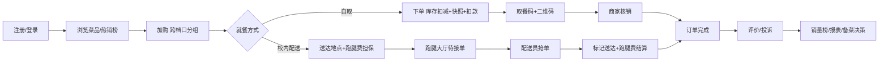

# 智慧校园食堂点餐系统 · 软件需求规格说明书（SRS）

| 项目 | 内容 |
|---|---|
| 文档编号 | SRS-CANTEEN-v1.1 |
| 版本 | v1.1 |
| 日期 | 2026-11-19 |
| 作者 / 评审人 | 闵娟 |
| 基线提交 | `f53f9d1` |
| 配套文档 | `SDD-CANTEEN-v1.1`（系统设计文档）、`MAN-CANTEEN-v1.1`（系统操作手册） |
| 变更说明 | 按评审意见整改：拆分需求与设计职责、权限矩阵按数据范围细化、非功能需求量化、追踪矩阵升级、状态三态化、措辞规范化 |
| 审批状态 | 待评审 |

## 修订历史

| 版本 | 日期 | 作者 | 变更说明 | 评审人 |
|---|---|---|---|---|
| v1.0 | 2026-11-18 | 伍梦圆 | 初稿，按基线 `f53f9d1` 核对 | 闵娟 |
| v1.1 | 2026-11-19 | 闵娟 | 按评审意见整改，三文档同权重写 | 闵娟 |

> 本文只描述"系统必须提供什么能力、达到什么质量、如何验收"。技术实现、架构、数据字典、接口契约、状态机、时序图、代码路径统一见 `SDD-CANTEEN-v1.1`；操作演示与角色操作步骤见 `MAN-CANTEEN-v1.1`；术语以本文附录 A 为准，三份文档统一引用。

## 目录

1. 引言
2. 项目背景与目标
3. 约束条件
4. 用户角色与权限矩阵
5. 功能需求
6. 典型用例
7. 业务闭环流程
8. 非功能需求
9. 数据需求
10. 范围边界
11. 可行性分析
12. 需求—实现追踪矩阵
13. 验收标准与交付状态
14. 遗留问题与风险登记册
附录 A 术语表 / 附录 B 图表索引

---

## 1. 引言

### 1.1 编写目的

明确"智慧校园食堂点餐系统"必须提供的能力、服务的对象、必须达到的质量标准与验收方法，作为后续设计、开发、测试与验收的需求基线。本文主线为 **需求 → 设计（见 SDD）→ 实现（见追踪矩阵）→ 验收（见第 13 节）**，每条需求均可定位到设计章节、实现位置与验收用例。

### 1.2 读者对象

- 项目组成员：开发与联调依据
- 任课教师与答辩评委：功能与技术评分依据
- 后续维护者：回归验收基线

### 1.3 文档范围与不适用范围

**本文范围内**：业务功能需求、角色与权限、非功能指标、数据对象概念模型、验收标准与追踪。

**本文范围外**（详见第 10 节与第 14 节风险登记册）：技术实现方案与架构图（见 SDD）、具体操作步骤与演示脚本（见操作手册）、接口字段级契约（见 SDD 附录）、测试执行记录（见操作手册附录 E 与压测报告）。

### 1.4 引用文件

| 文件 | 版本 | 用途 |
|---|---|---|
| 系统设计文档 | v1.1 | 架构、数据字典、状态机、时序、接口契约 |
| 系统操作手册 | v1.1 | 角色操作、演示脚本、验收记录表 |
| 防超卖压测报告 | v1.0 | 并发指标的实测证据 |

---

## 2. 项目背景与目标

### 2.1 背景与痛点

| # | 痛点 | 现状 | 系统对应能力 |
|---|---|---|---|
| P1 | 排队时间长 | 午餐高峰现场排队 10–20 分钟 | 线上提前点餐 + 取餐码/二维码，到店即取 |
| P2 | 限量菜信息不透明且易超卖 | 到档口才知道售完；瞬时抢购无保护会超卖 | 实时余量展示 + 限量菜并发保护（能力要求见 FR-STU-06，实现见 SDD） |
| P3 | 档口经营无数据 | 凭感觉备菜，损耗与缺货并存 | 销量统计与实时热销榜 |
| P4 | 校内配送无闭环 | 学生带餐回寝室无正规渠道 | 校内配送：送达地点 + 跑腿费担保交易 + 配送员抢单 |

### 2.2 项目目标

（1）学生可在线完成"浏览 → 加购 → 下单 → 取餐/送达 → 评价"的完整闭环；
（2）高峰期限量菜抢购零超卖，跨档口下单具备原子一致性；
（3）校内配送可抢单、可追踪、费用安全结算；
（4）四类角色权限隔离，关键操作全程留痕可审计；
（5）缓存服务不可用时主流程仍完整可用（见 NFR-A1）。

### 2.3 已交付亮点技术（答辩演示清单）

| # | 亮点 | 技术构成 | 入口 |
|---|---|---|---|
| H1 | 三重防超卖 | Redis `RAtomicLong` 预减 → Redisson 菜品锁 → MySQL `WHERE daily_stock>0` 条件更新 | 限量菜并发下单 |
| H2 | 实时热销榜 | Redis ZSet `rank:sale`（`incrementScore`/`reverseRange`），DB `sale_count` 兜底 | 学生首页 / 管理端总览 |
| H3 | 跨档口原子下单 | 单事务批量拆单 + `batch_no` + 统一锁集合 | 购物车多档口结算 |
| H4 | 退款全量回滚 | 余额 + 精确退券 + 库存 + 销量 + Redis 余量/榜单 | 取消订单 / 投诉成立退款 |
| H5 | 校园配送担保交易 | 2 元跑腿费冻结 + 送达结算 (`type=4`) + 抢单锁 | 跑腿大厅 / 配送调度 |
| H6 | 投诉超时升级 | 定时扫描 24h 未回应工单 + 手动升级 + 站内消息 | 商家投诉 / 管理端裁定 |
| H7 | AOP 操作日志落库 | `@OpLog` + 环绕通知 + `sys_operation_log` + 管理端查询 | 管理端「操作日志」 |
| H8 | AI Function Calling | DeepSeek `deepseek-chat` + 5 个工具函数 + 两轮调用 + 本地兜底 | 学生端悬浮助手「胆子肥嘟嘟」 |
| H9 | 二维码核销 + 语音播报 | 前端 qrcode 生成 5 分钟动态码；商家 Web Speech API 播报新订单 | 学生订单 / 商家出餐看板 |
| H10 | RBAC 四角色 + 优雅降级 | Spring Security URL 规则 + JWT 实时查库 + Redis 软依赖 | 全系统 |

> 早期规划的「接口限流 RRateLimiter」**未实现**，已从交付亮点中移除（见第 14 节）。

---

## 3. 约束条件

### 3.1 业务约束

| # | 约束 | 说明 |
|---|---|---|
| C-B1 | 支付为模拟钱包 | 不接入真实支付渠道，支付本质是钱包扣款事务 |
| C-B2 | 配送范围为校内 | 仅校内送达地点，无校外配送模块 |
| C-B3 | 商家为档口经营主体 | 一个档口对应一个档口商家账号 |
| C-B4 | 配送员为勤工助学场景 | 跑腿费作为服务费结算，不是商业配送 |

### 3.2 环境与运行约束

| # | 约束 | 说明 |
|---|---|---|
| C-E1 | 浏览器 | Chrome / Edge / Firefox 最近两个大版本，分辨率不低于 1366×768 |
| C-E2 | 服务端 | Java 11 或 17；MySQL 8；Redis 6；Docker Desktop |
| C-E3 | 本地教学配置 | 演示账号密码统一，缓存服务无密码仅限本地演示环境（敏感配置风险见 R-03） |
| C-E4 | AI 能力可选 | AI 助手需本地配置密钥；未配置时启用本地关键词应答（降级模式） |

> 技术选型理由与关键技术约束的落地方式统一见 SDD 第 2 节；本文不罗列类名、缓存键、SQL 条件、接口路径等实现细节。

---

## 4. 用户角色与权限矩阵

### 4.1 角色画像

| 角色 | 角色编码 | 使用动机 | 高频场景 | 登录端 |
|---|---|---|---|---|
| 学生 | `STUDENT` | 省时间、抢限量菜、用券、点校内配送 | 浏览/下单/订单/钱包/券/评价/投诉 | `/student` |
| 档口商家 | `MERCHANT` | 经营档口、核销出餐、看数据、处理投诉 | 菜品/出餐看板/统计/投诉回应 | `/merchant` |
| 校园配送员 | `RIDER` | 勤工助学、抢单获得跑腿费 | 跑腿大厅/我的配送/消息 | `/rider` |
| 管理员 | `ADMIN` | 维护秩序、审核入驻、兜底调度、审计 | 用户/档口/配送/投诉/券/日志/统计 | `/admin` |

注册默认创建学生角色；档口商家通过入驻申请生成待审核档口；配送员由管理员创建；管理员账号不开放注册。

### 4.2 权限矩阵（按数据范围拆分）

读法：● 允许；○ 不允许；△ 受流程约束。"仅本人/本档口"表示数据权限在业务层按归属校验（实现见 SDD 安全设计节）。

| 功能域 | 功能点 | 学生 | 档口商家 | 配送员 | 管理员 | 数据范围 / 说明 |
|---|---|---|---|---|---|---|
| 公共 | 登录/注册、菜品浏览、热销榜 | ● | ● | ● | ● | 无需鉴权或登录即可 |
| 学生 | 购物车、下单、取餐码/二维码、取消退款 | ● | ○ | ○ | ○ | 仅本人订单 |
| 钱包 | 充值（学生） | ● | ○ | ○ | ○ | 仅本人 |
| 钱包 | 余额/流水查询 | ● | ○ | ● | ○ | 仅本人；配送员查看跑腿费收入 |
| 管理 | 全局经营统计 | ○ | ○ | ○ | ● | 全局范围，非个人钱包 |
| 优惠券 | 领取、持有、下单使用 | ● | ○ | ○ | ○ | 仅本人领取记录 |
| 优惠券 | 投放、库存维护 | ○ | ○ | ○ | ● | 管理端投放，管理员不持有个人券 |
| 评价 | 提交菜品评价 | ● | ○ | ○ | ○ | 仅本人已完成订单 |
| 评价 | 查看本档口评价 | ○ | ● | ○ | ● | 商家仅本档口；管理员全局 |
| 投诉 | 发起投诉 | ● | ○ | ○ | ○ | 仅本人订单 |
| 投诉 | 回应投诉 | ○ | ● | ○ | ○ | 仅本档口投诉 |
| 投诉 | 裁定、退款、超时升级 | ○ | ○ | ○ | ● | 全局裁定 |
| 站内消息 | 查看本人通知、标记已读 | ● | ● | ● | ● | 仅本人消息 |
| 商家 | 本档口菜品增删改、上下架、日限量 | ○ | ● | ○ | ○ | 仅本档口 |
| 商家 | 出餐看板、取餐码核销 | ○ | ● | ○ | ○ | 仅本档口自取单 |
| 商家 | 本档口销量统计 | ○ | ● | ○ | ○ | 仅本档口 |
| 配送 | 跑腿大厅抢单、我的配送、标记送达 | ○ | ○ | ● | ○ | 仅本人接取的配送单 |
| 管理 | 配送员档案、兜底指派/送达 | ○ | ○ | ○ | ● | 全局；兜底送达不结算跑腿费（R-05） |
| 管理 | 用户管理、档口审核、券投放、操作日志 | ○ | ○ | ○ | ● | 全局 |

---

## 5. 功能需求

优先级：P0 核心主线（缺失则系统不成立）＞ P1 主线完整性 ＞ P2 增强项。
状态：已实现 / 已验收 / 待验收（截至基线 `f53f9d1`，状态见第 12 节追踪矩阵）。

### 5.1 公共与安全（FR-ALL）

| 编号 | 功能 | 优先级 | 状态 |
|---|---|---|---|
| FR-ALL-01 | 学生注册 | P0 | 已验收 |
| FR-ALL-02 | 档口商家入驻申请 | P1 | 已实现 |
| FR-ALL-03 | 登录 | P0 | 已验收 |
| FR-ALL-04 | 身份凭证鉴权 | P0 | 已验收 |
| FR-ALL-05 | 角色隔离 | P0 | 已验收 |
| FR-ALL-06 | 统一返回与异常处理 | P0 | 已验收 |
| FR-ALL-07 | 接口文档 | P1 | 已实现 |
| FR-ALL-08 | 当前用户查询 | P1 | 已验收 |
| FR-ALL-09 | 操作日志留痕与查询 | P1 | 已实现 |
| FR-ALL-10 | 站内消息中心 | P1 | 已实现 |

**FR-ALL-01 学生注册**（P0 · 已验收）

- **前置条件**：账号未占用
- **主流程**：提交账号/密码 → 创建学生账号 → 签发凭证
- **异常流程**：账号重复 → 拒绝并提示
- **后置条件**：账号可登录
- **验收标准**：新账号可登录，密码库中为密文

**FR-ALL-02 档口商家入驻申请**（P1 · 已实现）

- **前置条件**：账号未占用
- **主流程**：提交资料 → 创建账号 + 待审核档口
- **异常流程**：重复申请 → 拒绝
- **后置条件**：管理员可见待审核档口
- **验收标准**：提交后档口状态为待审核

**FR-ALL-03 登录**（P0 · 已验收）

- **前置条件**：账号存在且启用
- **主流程**：校验密码 → 签发凭证 → 返回角色
- **异常流程**：密码错误/账号禁用 → 拒绝并提示
- **后置条件**：获得有效凭证
- **验收标准**：错误密码/禁用账号被拒

**FR-ALL-04 身份凭证鉴权**（P0 · 已验收）

- **前置条件**：请求携带凭证
- **主流程**：解析凭证 → 实时加载角色 → 放行/拒绝
- **异常流程**：无/伪/过期凭证 → 401
- **后置条件**：请求被正确放行或拒绝
- **验收标准**：无/伪/过期凭证返回 401

**FR-ALL-05 角色隔离**（P0 · 已验收）

- **前置条件**：已登录
- **主流程**：按角色校验访问权限
- **异常流程**：越权访问 → 403
- **后置条件**：仅授权角色可访问
- **验收标准**：学生访问管理员能力返回 403

**FR-ALL-06 统一返回与异常处理**（P0 · 已验收）

- **前置条件**：任意请求
- **主流程**：成功/失败统一结构返回
- **异常流程**：异常 → 结构化错误，不暴露内部信息
- **后置条件**：响应结构一致
- **验收标准**：所有接口返回统一结构，异常不暴露内部细节

**FR-ALL-07 接口文档**（P1 · 已实现）

- **前置条件**：后端运行
- **主流程**：访问在线文档页
- **后置条件**：可查阅全部接口
- **验收标准**：接口文档页可访问且接口齐全

**FR-ALL-08 当前用户查询**（P1 · 已验收）

- **前置条件**：已登录
- **主流程**：返回当前身份与角色
- **异常流程**：未登录 → 401
- **后置条件**：前端获取身份
- **验收标准**：四类角色均可获取身份信息

**FR-ALL-09 操作日志留痕与查询**（P1 · 已实现）

- **前置条件**：关键操作发生
- **主流程**：记录模块/操作/操作人/参数摘要/耗时/结果
- **异常流程**：日志失败不影响业务
- **后置条件**：可按条件查询
- **验收标准**：关键操作可查询，最近 300 条；参数截断 300 字符；日志敏感字段脱敏未实现（R-09）

**FR-ALL-10 站内消息中心**（P1 · 已实现）

- **前置条件**：有通知事件
- **主流程**：生成通知 → 用户查看 → 标记已读
- **后置条件**：未读数清零
- **验收标准**：订单/入驻/投诉/配送通知可查、未读数与已读标记正确

### 5.2 学生端（FR-STU）

| 编号 | 功能 | 优先级 | 状态 |
|---|---|---|---|
| FR-STU-01 | 菜品浏览 | P0 | 已实现 |
| FR-STU-02 | 余量标签判定 | P0 | 已验收 |
| FR-STU-03 | 购物车 | P1 | 已实现 |
| FR-STU-04 | 单档口下单 | P0 | 已验收 |
| FR-STU-05 | 跨档口原子下单 | P1 | 已实现 |
| FR-STU-06 | 限量菜并发保护 | P0 | 已验收 |
| FR-STU-07 | 钱包 | P1 | 已实现 |
| FR-STU-08 | 优惠券使用 | P1 | 已实现 |
| FR-STU-09 | 取消订单与退款 | P1 | 已实现 |
| FR-STU-10 | 取餐码与二维码 | P1 | 已实现 |
| FR-STU-11 | 评价 | P1 | 已实现 |
| FR-STU-12 | 投诉发起 | P1 | 已实现 |
| FR-STU-13 | 实时热销榜 | P2 | 已实现 |
| FR-STU-14 | 校内配送下单 | P1 | 已实现 |

**FR-STU-01 菜品浏览**（P0 · 已实现）

- **前置条件**：档口营业中
- **主流程**：按食堂→档口→分类浏览、搜索、分页
- **异常流程**：无结果 → 空态提示
- **验收标准**：仅展示营业档口菜品；余量与销量可见

**FR-STU-02 余量标签判定**（P0 · 已验收）

- **前置条件**：菜品存在
- **主流程**：按限量标记与日库存展示标签
- **异常流程**：库存为 0 → 显示售罄
- **验收标准**：判定规则见 5.7

**FR-STU-03 购物车**（P1 · 已实现）

- **前置条件**：菜品在售
- **主流程**：加购/改量/删除，按档口分组
- **异常流程**：重复加购 → 数量累计
- **后置条件**：刷新不丢失
- **验收标准**：数量金额正确，跨档口分组展示

**FR-STU-04 单档口下单**（P0 · 已验收）

- **前置条件**：已登录、余额充足
- **主流程**：选自取/配送 → 校验库存 → 生成订单与取餐码 → 写明细快照 → 扣款 → 写流水 → 用券 → 加销量 → 清购物车
- **异常流程**：余额不足/库存不足 → 拒绝并提示；缓存不可用 → 降级（NFR-A1）
- **后置条件**：订单创建成功
- **验收标准**：字段完整、价格快照、余额不足拦截

**FR-STU-05 跨档口原子下单**（P1 · 已实现）

- **前置条件**：购物车含多档口
- **主流程**：一次提交多档口订单 → 全部成功或全部回滚
- **异常流程**：任一子单失败 → 全部回滚
- **后置条件**：生成批次号
- **验收标准**：单次最多 10 个档口；多档口时优惠券不参与抵扣；一次事务，失败全部回滚

**FR-STU-06 限量菜并发保护**（P0 · 已验收）

- **前置条件**：限量菜库存 N
- **主流程**：N 个并发请求各购 1 份
- **异常流程**：超出库存 → 返回售罄
- **后置条件**：库存归零
- **验收标准**：成功单数 = N，库存终值 = 0（判定方法见 NFR-C1）

**FR-STU-07 钱包**（P1 · 已实现）

- **前置条件**：已登录
- **主流程**：充值/查询余额/查询流水
- **异常流程**：余额不足下单 → 拦截
- **后置条件**：流水留痕
- **验收标准**：余额 = 流水累计

**FR-STU-08 优惠券使用**（P1 · 已实现）

- **前置条件**：有可用券
- **主流程**：领取 → 下单自动匹配最优券
- **异常流程**：券不可用/过期 → 不使用
- **后置条件**：券标记已用
- **验收标准**：不叠加，取满足门槛的最高面额一张；跑腿费不抵扣；多档口批量下单时自动关闭优惠券

**FR-STU-09 取消订单与退款**（P1 · 已实现）

- **前置条件**：订单待处理
- **主流程**：取消 → 退回余额 → 还原券/库存/销量
- **异常流程**：已完成订单 → 拒绝
- **后置条件**：订单状态变更
- **验收标准**：余额/券/库存/销量一致，防重复退款

**FR-STU-10 取餐码与二维码**（P1 · 已实现）

- **前置条件**：自取单待处理
- **主流程**：展示取餐码与动态二维码
- **异常流程**：二维码过期 → 自动刷新
- **验收标准**：仅待处理自取单可出示；二维码有效期 5 分钟，过期自动刷新

**FR-STU-11 评价**（P1 · 已实现）

- **前置条件**：订单已完成
- **主流程**：对菜品打 1–5 分 + 文字
- **异常流程**：重复评价/未完成 → 拒绝
- **后置条件**：评分聚合更新
- **验收标准**：仅本人已完成订单可评，一单一菜品一次

**FR-STU-12 投诉发起**（P1 · 已实现）

- **前置条件**：订单存在
- **主流程**：选择类型 + 填写内容提交
- **异常流程**：同一订单已有未结投诉 → 拒绝
- **后置条件**：生成投诉工单
- **验收标准**：同一订单仅一条未结投诉

**FR-STU-13 实时热销榜**（P2 · 已实现）

- **前置条件**：有销量数据
- **主流程**：下单后更新榜单
- **异常流程**：缓存不可用 → 按数据库销量排序
- **后置条件**：榜单更新
- **验收标准**：下单成功后 5 秒内更新；不可用时有降级展示

**FR-STU-14 校内配送下单**（P1 · 已实现）

- **前置条件**：已登录
- **主流程**：选配送 → 填写送达地点 → 支付跑腿费 → 下单
- **异常流程**：送达地点为空 → 不可提交
- **后置条件**：生成配送单，无取餐码
- **验收标准**：送达地点必填（可选具体楼栋）；券不抵扣跑腿费

### 5.3 档口商家端（FR-MER）

| 编号 | 功能 | 优先级 | 状态 |
|---|---|---|---|
| FR-MER-01 | 档口信息维护 | P1 | 已实现 |
| FR-MER-02 | 菜品管理 | P0 | 已实现 |
| FR-MER-03 | 出餐看板与核销 | P0 | 已验收 |
| FR-MER-04 | 新订单语音播报 | P2 | 已实现 |
| FR-MER-05 | 销量统计 | P1 | 已实现 |
| FR-MER-06 | 投诉回应 | P1 | 已实现 |

**FR-MER-01 档口信息维护**（P1 · 已实现）

- **前置条件**：档口已营业
- **主流程**：修改名称/营业状态
- **异常流程**：待审核档口 → 不可改营业状态
- **后置条件**：信息更新
- **验收标准**：仅能维护本档口

**FR-MER-02 菜品管理**（P0 · 已实现）

- **前置条件**：本档口存在
- **主流程**：增删改/上下架/设置日限量
- **异常流程**：跨档口操作 → 业务拒绝
- **后置条件**：学生端同步可见
- **验收标准**：变更即时反映学生端，仅本档口

**FR-MER-03 出餐看板与核销**（P0 · 已验收）

- **前置条件**：有待处理自取单
- **主流程**：查看队列 → 按取餐码核销（扫码或手工）
- **异常流程**：配送单/他人档口单 → 拒绝
- **后置条件**：订单状态变更
- **验收标准**：核销后订单完成，学生可评价；配送单不可核销

**FR-MER-04 新订单语音播报**（P2 · 已实现）

- **前置条件**：商家端开启
- **主流程**：轮询新增待处理单 → 语音播报
- **异常流程**：浏览器不支持 → 静默失败
- **验收标准**：可开关，不影响核销

**FR-MER-05 销量统计**（P1 · 已实现）

- **前置条件**：有订单数据
- **主流程**：按 7/14/30 天查看趋势与排行
- **验收标准**：图表数字与订单明细聚合一致

**FR-MER-06 投诉回应**（P1 · 已实现）

- **前置条件**：本档口有投诉
- **主流程**：提交回应
- **异常流程**：已裁定 → 不可再回应
- **后置条件**：投诉状态变更
- **验收标准**：仅本档口投诉，已裁定不可再回应

### 5.4 校园配送端（FR-RID）

| 编号 | 功能 | 优先级 | 状态 |
|---|---|---|---|
| FR-RID-01 | 跑腿大厅 | P0 | 已实现 |
| FR-RID-02 | 抢单 | P0 | 已验收 |
| FR-RID-03 | 我的配送与状态 | P1 | 已实现 |
| FR-RID-04 | 跑腿费结算 | P0 | 已验收 |
| FR-RID-05 | 在岗/停用 | P1 | 已实现 |

**FR-RID-01 跑腿大厅**（P0 · 已实现）

- **前置条件**：配送员在岗
- **主流程**：查看待接单列表
- **异常流程**：无待接单 → 空态
- **验收标准**：仅展示未分配的配送单

**FR-RID-02 抢单**（P0 · 已验收）

- **前置条件**：配送员在岗、订单未分配
- **主流程**：请求抢单 → 并发保护 → 成功后状态配送中
- **异常流程**：已被他人抢接 → 返回预期业务提示
- **后置条件**：订单绑定配送员
- **验收标准**：并发抢单仅一人成功，失败返回业务提示

**FR-RID-03 我的配送与状态**（P1 · 已实现）

- **前置条件**：已接单
- **主流程**：查看配送中订单 → 标记送达
- **异常流程**：非本人订单/跳级 → 拒绝
- **后置条件**：状态变更
- **验收标准**：状态 0→1→2，不可逆、不可跳级

**FR-RID-04 跑腿费结算**（P0 · 已验收）

- **前置条件**：配送单状态配送中
- **主流程**：标记送达 → 跑腿费计入本人钱包 → 写收入流水
- **异常流程**：重复送达 → 拒绝
- **后置条件**：余额与流水更新
- **验收标准**：仅本人单可送达；收入流水类型正确

**FR-RID-05 在岗/停用**（P1 · 已实现）

- **前置条件**：管理员设置
- **主流程**：停用后不可登录与抢单
- **异常流程**：停用账号登录 → 拒绝
- **验收标准**：停用后登录被拒、不可抢单

### 5.5 管理端（FR-ADM）

| 编号 | 功能 | 优先级 | 状态 |
|---|---|---|---|
| FR-ADM-01 | 用户管理 | P1 | 已实现 |
| FR-ADM-02 | 档口审核 | P1 | 已实现 |
| FR-ADM-03 | 配送员档案与调度 | P1 | 已实现 |
| FR-ADM-04 | 优惠券投放 | P1 | 已实现 |
| FR-ADM-05 | 全局统计 | P2 | 已实现 |
| FR-ADM-06 | 投诉裁定 | P1 | 已实现 |
| FR-ADM-07 | 超时升级 | P1 | 已实现 |
| FR-ADM-08 | 操作日志查询与清空 | P1 | 已实现 |

**FR-ADM-01 用户管理**（P1 · 已实现）

- **前置条件**：管理员登录
- **主流程**：搜索/禁用启用/改角色
- **异常流程**：操作自己 → 拒绝
- **后置条件**：用户状态变更
- **验收标准**：禁用后登录被拒；禁止改自己

**FR-ADM-02 档口审核**（P1 · 已实现）

- **前置条件**：有待审核档口
- **主流程**：通过（转营业）/驳回（停业）
- **异常流程**：重复审核 → 拒绝
- **后置条件**：档口状态变更，通知商家
- **验收标准**：通过后学生端可见

**FR-ADM-03 配送员档案与调度**（P1 · 已实现）

- **前置条件**：管理员登录
- **主流程**：新建/停用配送员、兜底指派/送达
- **异常流程**：指派停用配送员 → 拒绝
- **后置条件**：配送单状态变更
- **验收标准**：仅指派在岗配送员；兜底送达不结算跑腿费（R-05）

**FR-ADM-04 优惠券投放**（P1 · 已实现）

- **前置条件**：管理员登录
- **主流程**：新建券（门槛/面额/库存/有效期）
- **异常流程**：面额大于门槛/过期 → 拒绝
- **后置条件**：券可领取
- **验收标准**：校验面额≤门槛、未过期

**FR-ADM-05 全局统计**（P2 · 已实现）

- **前置条件**：有订单数据
- **主流程**：查看 GMV/订单/用户/档口排行/趋势
- **验收标准**：与明细聚合一致

**FR-ADM-06 投诉裁定**（P1 · 已实现）

- **前置条件**：投诉已回应或已超时
- **主流程**：裁定成立/不成立 → 可选退款
- **异常流程**：重复退款 → 拒绝
- **后置条件**：状态变更，按规则回滚
- **验收标准**：成立且退款时只退菜品金额、跑腿费不退；全量回滚副作用，防重复退款

**FR-ADM-07 超时升级**（P1 · 已实现）

- **前置条件**：投诉超时未回应
- **主流程**：定时扫描或手动触发 → 升级并通知
- **异常流程**：重复升级 → 幂等拒绝
- **后置条件**：工单标记升级
- **验收标准**：超过阈值自动升级，幂等处理，重复触发不重复通知

**FR-ADM-08 操作日志查询与清空**（P1 · 已实现）

- **前置条件**：有日志记录
- **主流程**：按操作人/模块/结果筛选、清空
- **异常流程**：清空需二次确认
- **验收标准**：可按条件查询最近 300 条

### 5.6 AI 助手（FR-AI）

| 编号 | 功能 | 优先级 | 状态 |
|---|---|---|---|
| FR-AI-01 | 悬浮助手与多会话 | P2 | 已实现 |
| FR-AI-02 | 智能问答与工具调用 | P2 | 已实现 |
| FR-AI-03 | 推荐卡片 | P2 | 已实现 |
| FR-AI-04 | 无密钥降级 | P2 | 已实现 |

**FR-AI-01 悬浮助手与多会话**（P2 · 已实现）

- **前置条件**：前端运行
- **主流程**：打开悬浮窗 → 多会话历史 → 删除/清空需确认
- **后置条件**：历史持久化
- **验收标准**：可拖动、位置持久化、历史可删除

**FR-AI-02 智能问答与工具调用**（P2 · 已实现）

- **前置条件**：配置 AI 密钥
- **主流程**：提问 → 工具调用 → 回填结果 → 生成回答
- **异常流程**：无密钥/请求失败 → 本地关键词应答（降级）
- **后置条件**：回答展示
- **验收标准**：支持查余额/订单/购物车/热销榜/加购；工具调用受角色约束，非学生角色仅开放查询类工具

**FR-AI-03 推荐卡片**（P2 · 已实现）

- **前置条件**：回答含菜品
- **主流程**：展示菜品卡片 → 可加购
- **后置条件**：加购成功
- **验收标准**：推荐菜品卡片可一键加购

**FR-AI-04 无密钥降级**（P2 · 已实现）

- **前置条件**：未配置密钥
- **主流程**：本地关键词应答
- **验收标准**：覆盖推荐/余额/订单/券/投诉/笑话/低卡七类关键词

### 5.7 余量标签判定规则（FR-STU-02 验收细则）

| 条件 | 展示标签 |
|---|---|
| 限量标记为否 | 不限量 |
| 限量标记为是，日库存 > 3 | 今日剩 N 份 |
| 限量标记为是，日库存 1–3 | 仅剩 N 份 |
| 限量标记为是，日库存 = 0 | 已售罄 |

> 阈值按当前实现，见 SDD 数据字典与前端实现说明；产品语义可后续调整；需求侧只要求“余量分级提示、售罄不可下单”。

> 限量标记与日库存的字段名与类型见 SDD 数据字典；本文只规定判定结果。

---

## 6. 典型用例

> 用例为业务视角，不含实现细节；实现流程见 SDD 时序图章节。

### UC-01 学生自取下单取餐（P0 主线）

- **参与者**：学生
- **前置条件**：已登录；目标档口营业中；钱包余额充足
- **触发**：学生主动点餐
- **主流程**：
  （1）浏览菜品 → 加购 → 结算（自取）；
  （2）系统校验菜品状态与库存、计算总价、匹配最优优惠券；
  （3）系统在一个事务内完成：库存扣减 → 建单（生成取餐码）→ 明细快照 → 扣款 → 写流水 → 用券 → 加销量 → 清购物车 → 通知商家；
  （4）学生查看取餐码 → 到档口出示二维码 → 商家核销 → 订单完成；
  （5）学生对已完成订单评价。
- **异常流程**：余额不足 → 拦截并提示充值；库存归零 → 提示售罄；缓存服务不可用 → 降级下单（NFR-A1）。
- **后置条件**：销量更新；流水留痕；热销榜更新（缓存可用时）。

### UC-02 限量菜并发抢购（P0 核心）

- **参与者**：多名学生并发
- **前置条件**：限量菜库存 N（演示数据 N=30）
- **触发**：限量菜开抢
- **主流程**：并发提交订单，系统对库存做并发保护，先到先得。
- **异常流程**：超出库存的请求返回售罄。
- **验收硬指标**：成功订单数 = N，库存终值 = 0；判定方法见 NFR-C1，实测记录见压测报告。

### UC-03 校内配送全流程（P0 主线）

- **参与者**：学生、校园配送员、管理员
- **前置条件**：学生已登录且有可用余额；配送员在岗
- **主流程**：
  （1）学生选择校内配送 → 填写送达地点 → 支付跑腿费 → 下单（无取餐码）；
  （2）配送员在跑腿大厅抢单（并发仅一人成功）；
  （3）配送员标记送达 → 订单完成 → 跑腿费结算到配送员钱包；
  （4）管理员可在必要时兜底指派/送达。
- **异常流程**：并发抢单失败 → 返回预期业务提示；送达地点为空 → 不可提交；管理员兜底送达不结算跑腿费（R-05）。
- **后置条件**：学生收到站内消息；配送员钱包产生收入流水。

### UC-04 跨档口原子下单（P1）

- **参与者**：学生
- **前置条件**：购物车含多个档口菜品
- **主流程**：一次提交 → 系统按档口分组 → 全部成功或全部回滚 → 生成相同批次号。
- **异常流程**：任一子单失败 → 全部回滚，购物车保留。
- **后置条件**：成功时生成多笔订单；失败时无部分落库。

### UC-05 投诉闭环与超时升级（P1）

- **参与者**：学生、档口商家、管理员
- **主流程**：学生投诉 → 商家回应（24 小时内）→ 管理员裁定；若商家超时未回应 → 系统自动升级（或管理员手动触发）→ 通知管理员。
- **异常流程**：裁定成立且勾选退款 → 只退菜品金额，全量回滚副作用，防重复退款。
- **后置条件**：投诉状态变更；相关方收到站内消息。

### UC-06 扫码核销与语音播报（P2）

- **参与者**：学生、档口商家
- **主流程**：学生出示 5 分钟有效的动态二维码 → 商家扫码或手工输入核销 → 订单完成；商家端可开启新订单语音播报。
- **异常流程**：二维码过期 → 学生端自动刷新；配送单不可核销。
- **后置条件**：订单状态变更，学生可评价。

---

## 7. 业务闭环流程

**图 7-1 业务闭环流程**

> 下游：取消/投诉成立 → 退款与副作用回滚；关键操作 → 操作日志；各节点 → 站内消息。

---

## 8. 非功能需求

每条指标含"指标 + 判定方法"，判定所需的实测记录见压测报告与操作手册附录 E。

| 类别 | 编号 | 指标 | 判定方法 |
|---|---|---|---|
| 性能 | NFR-P1 | 菜品分页 P95 < 800 ms（本地环境） | 接口压测记录 |
| 性能 | NFR-P2 | 下单 P95 < 2 s（本地环境） | 并发压测记录 |
| 并发一致性 | NFR-C1 | 库存 N 的限量菜，N 并发成功数 = N，终值 = 0 | 并发测试脚本；初始 30/并发 50 实测成功 30、失败（售罄）20、终值 0 |
| 并发一致性 | NFR-C2 | 并发抢单仅一人成功 | 并发脚本，失败返回预期业务提示 |
| 可用性 | NFR-A1 | 缓存服务不可用时，浏览/下单/核销主流程可用；降级在启动时生效 | 停止缓存服务后跑 UC-01/UC-03；实测缓存可用/不可用两种模式各 50 并发通过 |
| 可用性 | NFR-A2 | AI 密钥缺失时，本地关键词应答可用 | 不配置密钥后执行 FR-AI-04 |
| 一致性 | NFR-D1 | 跨档口下单全部成功或全部回滚 | 对账：批次号下所有子单状态一致 |
| 一致性 | NFR-D2 | 实付金额 = 明细聚合 + 跑腿费 − 优惠 | SQL 对账脚本 |
| 一致性 | NFR-D3 | 退款后余额/券/库存/销量/榜单一致 | 对账脚本 + 防重复退款校验 |
| 安全 | NFR-S1 | 密码单向加密、库中零明文（已实现）；日志敏感字段脱敏未实现（R-09） | 数据库与日志抽查 |
| 安全 | NFR-S2 | 凭证有效期 24 小时；过期/伪造凭证返回 401 | 安全用例 |
| 安全 | NFR-S3 | 越权访问返回 403；禁用与角色变更即时生效 | 安全用例 |
| 安全 | NFR-S4 | 角色与数据权限按归属校验 | 越权用例（跨档口/跨订单） |
| 可维护性 | NFR-M1 | 关键操作落日志，可查询最近 300 条 | 管理端日志页抽查 |
| 可维护性 | NFR-M2 | 配置外置；增量脚本有明确执行顺序 | 部署检查 |
| 兼容性 | NFR-CP1 | Chrome/Edge/Firefox 最近两个大版本；Java 11/17；MySQL 8；Redis 6 | 环境矩阵 |

---

## 9. 数据需求

### 9.1 数据对象（概念级）

| 域 | 数据对象 | 用途 | 保留 / 隐私要求 |
|---|---|---|---|
| 身份与权限 | 账号、角色、权限点、角色权限映射 | 身份与授权 | 密码只存密文，不对外展示 |
| 食堂 | 食堂、档口、分类、菜品 | 点餐目录 | 菜品含限量标记与日库存 |
| 交易 | 购物车、订单、订单明细、钱包流水 | 交易主链 | 明细保存下单时快照；流水不可篡改 |
| 营销 | 优惠券、领券记录 | 优惠 | 领券记录与订单精确关联 |
| 反馈 | 评价、投诉工单 | 服务反馈 | 投诉含裁定结果与退款标记 |
| 配送 | 配送员档案 | 校内配送 | 绑定账号，含在岗状态 |
| 系统 | 站内消息、操作日志 | 通知与审计 | 操作日志参数摘要（截断 300 字符）；日志敏感字段脱敏未实现（R-09） |

### 9.2 初始演示数据

- 演示账号（密码统一，仅演示环境）：学生、两个档口商家、两个配送员（在岗/停用）、管理员。
- 2 个食堂、3 个档口（含 1 个待审核）、5 个分类、20 道菜（含 7 道限量菜）、2 张满减券、基础 10 个权限点（增量脚本追加 2 个后共 12 个）。
- 演示数据以操作手册第 2 节为唯一来源；重置流程见操作手册附录 D。

> 字段级数据字典、索引、枚举、约束见 SDD 数据设计章节。

---

## 10. 范围边界

### 10.1 本期交付

第 5 节全部功能需求；四类角色完整闭环；质量指标见第 8 节。

### 10.2 本期不交付

| # | 不交付项 | 理由 | 风险编号 |
|---|---|---|---|
| N1 | 真实支付渠道 | 教学环境无法接入；用模拟钱包替代 | — |
| N2 | 校园统一身份认证 | 无真实接口资源 | — |
| N3 | 接口限流 | 早期规划未落地，保留扩展点 | R-01 |
| N4 | 服务端二维码验签 | 二维码在前端生成与校验，后端按取餐码核销 | R-07 |
| N5 | 后端 AI 服务代理 | AI 在浏览器端直连模型服务 | R-03 |
| N6 | 校外配送 / 多校区 | 超出课程作业规模 | — |
| N7 | 短信/邮件通知 | 站内消息替代 | — |

### 10.3 后续演进

限流能力、增量脚本幂等化、服务端票据验签、密钥后端代理、JDK 版本统一（见第 14 节）。

---

## 11. 可行性分析

| 维度 | 结论 | 依据 |
|---|---|---|
| 技术可行性 | 成立 | 课程要求的技术栈均有可运行证据；核心难点（限量菜并发）含降级路径；详见 SDD 选型与核心设计 |
| 经济可行性 | 成立 | 全开源技术栈，基础设施本机容器化，无云服务成本 |
| 操作可行性 | 成立 | 四角色均有明确入口与操作步骤，见操作手册 |
| 进度可行性 | 成立 | 截至基线 `f53f9d1`，P0/P1 需求均已实现，验收状态见第 12 节 |

---

## 12. 需求—实现追踪矩阵

> 五列：需求编号 → 设计章节 → 实现位置/基线 → 验收用例 → 状态。
> 状态：已实现 / 已验收 / 待验收。P0 需求全覆盖。

| 需求编号 | 设计章节（SDD） | 实现位置 / 基线 | 验收用例 | 状态 |
|---|---|---|---|---|
| FR-ALL-01/02/03 | 7 安全设计、6 接口设计 | 见 SDD 代码索引 | TC-ALL-01 注册登录 | 见 5.1 表 |
| FR-ALL-04/05 | 7 安全设计 | 见 SDD 代码索引 | TC-ALL-04 401/403 | 已验收 |
| FR-ALL-06 | 6 接口设计 | 见 SDD 代码索引 | TC-ALL-06 返回结构 | 已验收 |
| FR-ALL-07/08 | 6 接口设计 | 见 SDD 代码索引 | TC-ALL-07/08 | 见 5.1 表 |
| FR-ALL-09 | 8 横切核心组件、7 安全设计 | 见 SDD 代码索引 | TC-ALL-09 日志落库 | 已实现 |
| FR-ALL-10 | 3 数据设计、6 接口设计 | 见 SDD 代码索引 | TC-ALL-10 消息中心 | 已实现 |
| FR-STU-01/02 | 3 数据设计 | 见 SDD 代码索引 | TC-STU-01/02 浏览与标签 | 见 5.2 表 |
| FR-STU-03 | 3 数据设计 | 见 SDD 代码索引 | TC-STU-03 购物车 | 已实现 |
| FR-STU-04 | 4 核心流程设计 | 见 SDD 代码索引 | TC-STU-04 下单 | 已验收 |
| FR-STU-05 | 4.2 批量下单 | 见 SDD 代码索引 | TC-STU-05 原子拆单 | 已实现 |
| FR-STU-06 | 4.1 并发保护 | 见 SDD 代码索引 | TC-STU-06 并发压测 | 已验收 |
| FR-STU-07/08 | 3 数据设计 | 见 SDD 代码索引 | TC-STU-07/08 | 已实现 |
| FR-STU-09 | 4.3 退款回滚 | 见 SDD 代码索引 | TC-STU-09 退款回滚 | 已实现 |
| FR-STU-10 | 4.8 二维码核销 | 见 SDD 代码索引 | TC-STU-10 二维码 | 已实现 |
| FR-STU-11/12 | 3 数据设计 | 见 SDD 代码索引 | TC-STU-11/12 | 已实现 |
| FR-STU-13 | 4.9 缓存降级 | 见 SDD 代码索引 | TC-STU-13 榜单 | 已实现 |
| FR-STU-14 | 4.4 配送担保 | 见 SDD 代码索引 | TC-STU-14 配送下单 | 已实现 |
| FR-MER-01~06 | 3 数据设计、6 接口设计 | 见 SDD 代码索引 | TC-MER-01~06 | 见 5.3 表 |
| FR-RID-01~05 | 4.4 配送担保与抢单 | 见 SDD 代码索引 | TC-RID-01~05 | 见 5.4 表 |
| FR-ADM-01~08 | 7 安全设计、4.5 投诉升级 | 见 SDD 代码索引 | TC-ADM-01~08 | 已实现 |
| FR-AI-01~04 | 4.7 AI 助手 | 见 SDD 代码索引 | TC-AI-01~04 | 已实现 |
| 数据需求 | 数据设计 | 16 张基础表 + 3 个增量脚本（追加 4 张表，共 20 表） | TC-DATA-01 初始化 | 已验收 |

---

## 13. 验收标准与交付状态

| 里程碑 | 原计划 | 交付状态 | 验收依据 |
|---|---|---|---|
| M1 登录可用 | 第 1 周 | 已验收 | TC-ALL-01~08 |
| M2 点餐主线 | 第 2 周 | 已验收 | TC-STU-01~10 |
| M3 配套完整 | 第 3 周 | 已验收 | TC-STU-11~14 / TC-MER / TC-ADM |
| M4 亮点定稿 | 第 4 周 | 已实现（验收记录见操作手册附录 E） | TC-RID / TC-AI / 压测报告 |

**验收口径**：第 12 节追踪矩阵中 P0 需求状态为已验收；NFR-C1/NFR-C2 并发指标有实测记录；四角色流程按操作手册可独立走通；三份文档版本与基线一致。

**交付状态说明**：截至基线 `f53f9d1`，P0/P1 需求均已实现，验收状态见第 12 节；未验收项列入第 14 节风险登记册并明确了处置。

---

## 14. 遗留问题与风险登记册

> R-01~R-09 三份文档统一引用；处置与责任人在 SDD 风险登记册与操作手册安全提示中呼应。

| 编号 | 风险 / 遗留项 | 影响 | 概率 | 处置 | 状态 |
|---|---|---|---|---|---|
| R-01 | 接口限流未实现 | 高频刷接口无保护 | 中 | 保留扩展点，后续加切面实现 | 已登记 |
| R-02 | 增量脚本非幂等 | 重复执行报错 | 中 | 部署文档明确执行顺序与后果，后续合并入基础脚本 | 已登记 |
| R-03 | 敏感配置暴露（缓存服务无密码、AI 密钥前端直连） | 配置/密钥泄露风险 | 中 | 仅限本地教学演示环境；生产须启用密码与后端代理 | 已登记 |
| R-04 | 缓存服务仅启动时探测一次 | 恢复后需重启后端 | 中 | 文档明确该行为；后续可加健康检查 | 已登记 |
| R-05 | 管理端兜底送达不结算跑腿费 | 配送员收入口径 | 低 | 设计如此，如需代结算须新增规则 | 已登记 |
| R-06 | 钱包流水类型注释与实际不符 | 数据字典不一致 | 低 | 后续补数据库注释 | 已登记 |
| R-07 | 二维码前端生成与校验 | 无服务端验签 | 低 | 教学场景可接受；生产须后端签发一次性票据 | 已登记 |
| R-08 | JDK 版本口径不统一 | 高版本需注解处理器配置 | 中 | 运行口径统一 Java 11/17；保留兼容配置 | 已登记 |
| R-09 | 操作日志敏感字段脱敏未实现 | 密码/凭证可能进入日志参数摘要 | 中 | 当前仅做 300 字符截断；后续增加字段级脱敏 | 已登记 |

---

## 附录 A 术语表

| 术语 | 定义 |
|---|---|
| 档口 | 食堂内独立经营的餐饮单元，对应一个档口商家账号 |
| 档口商家 | 经营档口的用户角色（统一用词，不用"商家/店铺/档口商"） |
| 限量菜 | 带限量标记且日库存大于 0 的菜品；售完即不可下单 |
| 取餐码 | 自取单下单成功后生成的 4 位数字，当日同档口内唯一；配送单无取餐码 |
| 核销 | 档口商家确认取餐码对应订单完成出餐 |
| 校内配送 | 勤工助学场景下的校内送达：送达地点 + 跑腿费担保交易 + 配送员抢单 |
| 跑腿费担保交易 | 下单时跑腿费暂存平台，配送员确认送达后结算到其钱包 |
| 抢单锁 | 保证一个配送单仅被一位配送员接取的并发保护机制（实现见 SDD） |
| 原子拆单 | 跨档口购物车在一次事务内生成多笔子订单，全部成功或全部回滚 |
| 降级 | 增强能力失效时的替代处理，保证主流程可用 |
| 兜底 | 主流程异常时由管理员人工介入处理（如兜底指派/送达），与"降级"不同义 |
| 软依赖 | 主流程不依赖某组件的成功，该组件不可用时以降级方式运行（首次定义，后续统一用"降级"） |
| RBAC | 基于角色的访问控制，四类角色：学生/档口商家/校园配送员/管理员 |

## 附录 B 图表索引

| 图号 | 名称 | 位置 |
|---|---|---|
| 图 7-1 | 业务闭环流程 | 第 7 节 |

> 其余图（架构图、ER 图、状态机图、时序图）编号与占位见 SDD 图表索引；操作手册为纯文字操作步骤，不配截图。

---

> 本文档为 SRS v1.1，配套 SDD v1.1 与操作手册 v1.1，基线 `f53f9d1`。文中状态词统一为"已实现/已验收/待验收"，风险统一引用 R-01~R-09。

