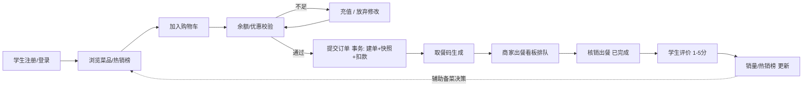

# 智慧校园食堂点餐系统 · 需求分析文档

| 项目 | 内容 |
|---|---|
| 文档版本 | v0.9（初稿，待责任人修润定稿） |
| 责任人 | 组员 C |
| 状态 | 编写中（计划第 4 周前定稿） |
| 编写依据 | 《阶段一项目搭建总结与计划》《sql/schema.sql》已实现代码与实测记录 |
| 说明 | 按组规：AI 协助生成初稿，需人工修改至个人风格后再定稿提交 |

## 目录

1. [引言](#1-引言)
2. [项目背景与目标](#2-项目背景与目标)
3. [约束条件与硬性技术要求](#3-约束条件与硬性技术要求)
4. [用户角色分析与权限矩阵](#4-用户角色分析与权限矩阵)
5. [功能需求](#5-功能需求)
6. [典型用例](#6-典型用例)
7. [业务闭环流程](#7-业务闭环流程)
8. [非功能需求](#8-非功能需求)
9. [数据需求](#9-数据需求)
10. [范围边界（明确不做的）](#10-范围边界)
11. [可行性分析](#11-可行性分析)
12. [需求—实现追踪表](#12-需求实现追踪表)
13. [验收标准与里程碑](#13-验收标准与里程碑)
14. [遗留问题与开放决策](#14-遗留问题与开放决策)

---

## 1. 引言

### 1.1 编写目的

明确"智慧校园食堂点餐系统"要解决的问题、服务的对象、必须实现的功能与必须达到的质量标准，作为后续设计、开发、测试与验收的统一基线。所有功能开发与答辩演示的一条主线：**需求 → 实现 → 验证**均可在此文档中定位。

### 1.2 读者对象

- 小组成员（开发与联调依据）
- 任课教师与答辩评委（过程管理评分依据）
- 后续维护者（回归验收基线）

### 1.3 术语表

| 术语 | 定义 |
|---|---|
| 档口 | 食堂内独立经营的餐饮档口，一个档口对应一个商家账号 |
| 限量菜 | 配置了 `daily_stock`（每日限量数 > 0）的菜品，当日售完即下架，是"防超卖"与"抢购"演示的核心对象 |
| 取餐码 | 下单成功后生成的短码（如 8 位），学生凭码到档口出餐口取餐，档口按码核销出餐 |
| 核销 | 商家确认取餐码对应订单已完成出餐的记账动作，订单状态由此变为"已完成" |
| RBAC | 基于角色的访问控制（Role-Based Access Control），本系统采用 用户-角色-菜单权限 五表模型 |
| 降级模式 | Redis 不可用时系统自动切换的运行方式：主流程（登录/浏览/下单）不受影响，仅亮点功能（热销榜/分布式锁/限流）暂不可用，详见 8.3 |

---

## 2. 项目背景与目标

### 2.1 背景与痛点

校园食堂就餐高峰集中在午餐 11:30–12:30 的约 60 分钟内，存在三类可观测问题：

| # | 痛点 | 现状描述 | 本系统对应化解 |
|---|---|---|---|
| P1 | **排队时间长** | 学生必须到现场排队点餐、等餐，高峰期排队 10–20 分钟 | 线上提前点餐 + 取餐码，到店即取，评价与历史订单沉淀二次复购 |
| P2 | **限量菜信息不透明** | 红烧排骨等热门限量菜"到档口才知道卖完了"，学生白排队；且瞬时抢购在无保护时会出现超卖（上一份亏本、下一份失信） | 菜品实时展示限量余量；高并发抢购采用 Redis 预减库存 + 分布式锁 + 数据库条件更新**三重防超卖** |
| P3 | **商家经营无数据** | 档口老板凭感觉备菜，卖不动的菜堆损耗，热销菜常备不足 | 销量统计报表 + ECharts 可视化 + 实时热销榜，辅助备菜决策 |

### 2.2 项目目标

构建一个前后端分离的智慧校园食堂点餐系统，达成：

1. 学生可在线完成 浏览→加购→下单→取餐→评价 的完整闭环；
2. 高峰期限量菜抢购**零超卖**，且体验上先到先得；
3. 商家与管理员获得真实经营数据与可视化看板；
4. 三类角色权限严格隔离，关键操作全程留痕可审计。

### 2.3 预期亮点技术（答辩重点演示）

| # | 亮点 | 技术构成 | 演示方式 |
|---|---|---|---|
| H1 | 高并发防超卖 | Redis 预减库存 + Redisson 分布式锁 + MySQL 条件更新双保险 | 限量菜并发下单压测，库存不越界 |
| H2 | 实时热销榜 | Redis ZSet（`incrementScore` 写入 + `reverseRange` 读取） | 下单后榜单秒级变化 |
| H3 | 接口限流防刷 | Redisson RRateLimiter + 注解式拦截（取餐码查询/下单接口） | 脚本高频请求被拒 |
| H4 | RBAC 三角色权限体系 | Spring Security + 五表模型 + JWT | 学生调管理员接口得 403 |
| H5 | 销量数据可视化 | ECharts + 订单聚合统计 | 商家端报表页 |
| H6 | 优雅降级 | Redis 软依赖设计（第 1 周已落地） | 停 Redis 后主流程照常演示 |

---

## 3. 约束条件与硬性技术要求

本作业为《Java 高级开发技术》期末大作业，技术栈为课程硬性约束，**逐条对照如下**（此表同时是评分对答依据，随开发推进更新"证据"列）：

| # | 课程要求 | 本组选型 | 当前实现证据（截至第 1 周） | 状态 |
|---|---|---|---|---|
| R-1 | 前后端分离 | Vue 3 + Vite 5 / Spring Boot 2.7.18 | `frontend/src`、`backend/src`；axios 统一走 `/api` 代理 | ✅ 已落地 |
| R-2 | Vue 前端框架 | Vue 3 + Vue Router + Pinia | 三角色三布局路由 + 守卫 + localStorage 登录态 | ✅ 已落地 |
| R-3 | Spring Boot 后端 | Spring Boot 2.7.18（JDK 11 目标） | 统一返回体/全局异常/分层结构 | ✅ 已落地 |
| R-4 | MyBatis 数据访问 | mybatis-spring-boot-starter + PageHelper | UserMapper/RoleMapper + XML 映射、下划线转驼峰 | ✅ 已落地 |
| R-5 | Redis 缓存 | spring-data-redis + Redisson 3.23.5 | RedisSupport 软依赖封装；防超卖/热销榜将用 | ✅ 基础已落地 |
| R-6 | slf4j 日志框架 | Logback（按天滚动 + 错误单独文件） | `logs/canteen.log`；@OpLog 切面留痕，实测密码零明文 | ✅ 已落地 |
| R-7 | Spring Security | Security 5.7 + JWT（jjwt 0.11.5） | JWT 过滤器 + RBAC 路径/方法鉴权，401/403 全链路实测 | ✅ 已落地 |
| R-8 | 必含 RBAC 设计 | user/role/user_role/menu/role_menu 五表 | 建表 + 数据 + 鉴权规则齐备（见 9.1） | ✅ 已落地 |
| R-9 | 重点业务+亮点 | 点餐防超卖为核心业务，H1–H6 为亮点 | 防超卖/热销榜/限流计划第 2–4 周实现 | 🚧 进行中 |

> **补充约束**：本机 JDK 25 过新（Lombok 兼容性问题，已通过注解处理器配置解决）；Redis 官方无 Windows 版（已统一 Docker 方案，见《环境安装_Redis.md》）；团队成员开发环境以 `docker-compose.yml` 一键对齐。

---

## 4. 用户角色分析与权限矩阵

### 4.1 角色画像

| 角色 | 角色编码 | 使用动机 | 高频场景 | 出现时段 |
|---|---|---|---|---|
| 学生（普通用户） | `STUDENT` | 省时间去排队、抢限量菜、攒优惠券 | 浏览/加购/下单/取餐/评价/钱包 | 午餐高峰为主 |
| 档口商家 | `MERCHANT` | 经营自己的档口、看数据、核销出餐 | 菜品管理/出餐看板/销量统计/档口审核跟进 | 备餐时段 + 高峰 |
| 系统管理员 | `ADMIN` | 维护平台秩序、审核入驻、看全局 | 用户管理/档口审核/优惠券投放/全局统计 | 不定时 |

注册接口默认创建 `STUDENT` 角色；商家与管理员账号由管理员侧录入或改绑（与现有 `UserServiceImpl.register` 逻辑一致）。

### 4.2 权限矩阵（角色 × 功能）

读法：● = 允许；○ = 不允许；△ = 受审核流程约束。

| 功能域 | 功能点 | 学生 | 商家 | 管理员 | 对应权限编码（menu 表） |
|---|---|---|---|---|---|
| 浏览/点餐 | 菜品浏览、热销榜查看 | ● | ● | ● | （登录即可） |
| 浏览/点餐 | 购物车、下单、取餐码 | ● | ○ | ○ | （登录即可） |
| 钱包/优惠券 | 充值、退款查询、领券、用券 | ● | ○ | ○ | （登录即可） |
| 评价 | 对已完成订单的菜品评分 | ● | ○ | ○ | （登录即可） |
| 商家 | 菜品增删改（限本档口） | ○ | ● | ○ | dish:add / dish:update / dish:delete |
| 商家 | 出餐看板（本档口订单核销） | ○ | ● | ○ | order:list / order:deliver |
| 商家 | 本档口销量统计 | ○ | ● | ○ | stats:view |
| 管理端 | 用户管理（禁用/启用） | ○ | ○ | ● | user:list / user:ban |
| 管理端 | 档口审核（入驻/停业） | ○ | ○ | ● | stall:audit |
| 管理端 | 优惠券投放 | ○ | ○ | ● | coupon:grant |
| 管理端 | 全局统计 | ○ | ○ | ● | stats:view |
| 安全 | 登录/注册、健康检查、接口文档 | ● | ● | ● | （白名单放行） |

> 上表编码与 `sql/init_data.sql` 中 `menu` 表初始数据一一对应；管理员全量授权、商家限业务权限、学生端走"登录即可"，与第 1 周已实测的 Security 规则一致（`/api/admin/**`→ADMIN，`/api/merchant/**`→MERCHANT，其余登录即可）。

---

## 5. 功能需求

编号规则：`FR-<端域>-<序号>`；优先级 P0（核心主线，缺则系统不成立）＞ P1（主线完整性）＞ P2（增强项）；状态：✅ 第 1 周已实现 / 🚧 第 2–3 周 / 📋 第 3–4 周。

### 5.1 公共与安全（平台底座）

| 编号 | 功能 | 优先级 | 验收标准 | 状态 |
|---|---|---|---|---|
| FR-ALL-01 | 注册（默认学生角色，注册即登录，BCrypt 加密） | P0 | 新账号可登录，密码库中为密文；重复注册被拒 | ✅ |
| FR-ALL-02 | 登录（返回 JWT：userId/username/role，24h 有效） | P0 | 正确密码 200 拿 token；错误密码被拒并提示；禁用账号禁止登录 | ✅ |
| FR-ALL-03 | JWT 鉴权过滤器（无状态，角色实时查库） | P0 | 无/伪/过期 token 访问受保护接口 → 401；改库中角色后旧 token 权限即时变化 | ✅ |
| FR-ALL-04 | RBAC 鉴权（URL 规则 + @PreAuthorize 方法级） | P0 | 学生调 `/api/admin/**` → 403；管理员放行 | ✅ |
| FR-ALL-05 | 统一返回体与全局异常处理 | P0 | 所有接口返回 `{code,message,data}`；异常不暴露堆栈 | ✅ |
| FR-ALL-06 | 接口文档（knife4j） | P1 | `/doc.html` 可见全部接口与参数说明 | ✅ |
| FR-ALL-07 | 当前用户信息接口 `/api/user/me` | P1 | 任意角色携带 token 获取 userId/roles，前端导航与个人中心用 | ✅ |
| FR-ALL-08 | 操作日志留痕（@OpLog：登录/注册/下单/支付等） | P1 | `logs/canteen.log` 可检索到关键操作记录，密码等敏感字段不出现在日志 | ✅ |
| FR-ALL-09 | 接口限流（下单/取餐码查询等易刷接口） | P1 | 超过阈值（见 8.2）的请求返回"操作过于频繁"，Redis 不可用时降级放行并告警 | 🚧 |

### 5.2 学生端（STUDENT）

| 编号 | 功能 | 优先级 | 验收标准 | 状态 |
|---|---|---|---|---|
| FR-STU-01 | 菜品浏览（按食堂→档口→分类导航；展示名称/价格/图片/余量/月销） | P0 | 列表分页正确；限量菜余量实时展示 | 🚧 |
| FR-STU-02 | 菜品搜索与筛选 | P2 | 按名称模糊搜索、分类筛选可用 | 📋 |
| FR-STU-03 | 购物车（同一档口内加购/改量/删除，跨档口下单拆单或提示） | P1 | 加购后数量/金额正确；刷新不丢（DB 存储） | 🚧 |
| FR-STU-04 | 下单（生成订单 + 明细快照 + 取餐码；同一事务） | P0 | 订单落库字段完整；取餐码唯一；明细保存下单时价格**快照** | 🚧 |
| FR-STU-05 | 限量菜抢购防超卖 | P0 | 并发下单后 `dish.daily_stock` 剩余数与实际成功订单数之和**恒等于**初始限量（不超卖、不少卖） | 🚧 |
| FR-STU-06 | 模拟钱包（充值/余额/扣款/退款流水） | P1 | 余额=流水累计；下单扣款与订单事务一致；余额不足拦截 | 🚧 |
| FR-STU-07 | 优惠券（浏览可领券/领取/下单满足门槛自动核销） | P1 | 领取属人限量；核算：`pay_amount = total_amount - discount_amount ≥ 0` | 🚧 |
| FR-STU-08 | 我的订单（列表/详情/待取餐/已完成/已取消） | P1 | 螺旋按状态筛选正确，可见取餐码 | 🚧 |
| FR-STU-09 | 评价（对已完成订单菜品打 1–5 分 + 文字） | P1 | 仅限本人已完成订单；评价聚合影响菜品评分展示 | 📋 |
| FR-STU-10 | 实时热销榜 | P2 | 下单成功后 TopN 榜单秒级更新（Redis ZSet） | 📋 |

### 5.3 商家端（MERCHANT）

| 编号 | 功能 | 优先级 | 验收标准 | 状态 |
|---|---|---|---|---|
| FR-MER-01 | 档口信息维护（名称/今日营业状态） | P1 | 仅能编辑本人 `merchant_user_id` 档口 | 🚧 |
| FR-MER-02 | 菜品管理（增删改/上下架/设置每日限量） | P0 | 变更即时反映学生端；仅限本档口（数据权限隔离） | 🚧 |
| FR-MER-03 | 出餐看板（待出餐队列 + 取餐码核销） | P0 | 核销后订单变"已完成"并解锁评价资格；他人档口订单不可见 | 🚧 |
| FR-MER-04 | 销量统计（日/周/月销量，ECharts 折线与排行） | P1 | 图表数字与订单明细聚合一致 | 📋 |

### 5.4 管理端（ADMIN）

| 编号 | 功能 | 优先级 | 验收标准 | 状态 |
|---|---|---|---|---|
| FR-ADM-01 | 用户管理（列表/搜索/禁用/启用/重置角色） | P1 | 禁用后该用户登录被拒（"账号已被禁用"）；禁用即时影响已有 token（角色实时查库已具备，状态过滤登录链已具备） | 🚧 |
| FR-ADM-02 | 档口审核（新档口 `status=2 待审核` → 通过=1 / 驳回） | P1 | 审核通过后该档口菜品对学生端可见；全程日志留痕 | 🚧 |
| FR-ADM-03 | 优惠券投放（满减阈值/数量/有效期） | P1 | 库存扣减正确；过期自动停发 | 🚧 |
| FR-ADM-04 | 全局统计（两食堂/各档口 GMV 与订单量） | P2 | 与商家自报数据可交叉核对 | 📋 |

---

## 6. 典型用例

### UC-01 学生正常下单取餐（P0 主线）

- **参与者**：学生；**触发**：学生主动点餐
- **前置**：已登录；目标档口营业中；钱包余额充足
- **主流程**：
  1. 浏览菜品 → 选"宫保鸡丁 ×2、米饭 ×1"加入购物车；
  2. 确认下单 → 系统校验 菜品在售状态与库存 → 计算总价 → 逐项匹配可用优惠券（满足最高门槛者默认选用）；
  3. 同一事务内：创建订单（生成取餐码）→ 写明细（价格快照）→ 钱包扣款 → 写流水；
  4. 前端展示 取餐码 + 订单号，学生到档口报码取餐；
  5. 商家核销 → 订单状态"已完成" → 解锁评价。
- **后置**：菜品销量 +N；钱包流水留痕；热销榜加分（若 Redis 可用）。
- **异常流**：余额不足 → 拦截并提示充值；菜品下架/库存归零 → 允许剔除该菜品继续下单；Redis 故障 → 走降级下单（仍不超卖，见 8.3）。

### UC-02 限量菜高并发抢购（P0 核心亮点 H1）

- **参与者**：多名学生并发；**触发**：限量菜（如红烧排骨 `daily_stock=30`）开抢
- **主流程**：
  1. 请求进入 → 接口限流闸门（H3）；
  2. Redis `DECR` 预减库存 → **结果 < 0 直接返回"已抢完"**，不再穿透到数据库；
  3. 通过者进入 Redisson 分布式锁（菜品维度）；
  4. MySQL 条件更新扣库 `UPDATE dish SET daily_stock = daily_stock - 1 WHERE id=? AND daily_stock > 0` —— 影响行数=0 即失败回滚；

     > 注：设计文档中"乐观锁"以**数据库条件更新（where stock > 0）**形式落地，配合 Redis 预减构成双保险。
  5. 建单 + 扣款（同一事务）。
- **验收硬指标（FR-STU-05）**：N 并发 × 每人 1 份 → 成功订单数 = 30，`daily_stock` 终值 = 0，**多一份即超卖 = 不合格，少一份 = 不少卖**；压测报告归档进答辩材料。

### UC-03 档口入驻审核（P1）

- **参与者**：商家、管理员；**触发**：新商家账号入驻/新档口提交
- **主流程**：新档口落库 `status=2 待审核`（演示数据已预置一条）→ 管理员在"档口审核"页查看 → **通过**（状态=1 营业，菜品对学生可见）或 **驳回**（可注明原因）→ 操作进入日志。
- **异常流**：商家重复提交多个档口 → 需管理员逐条处理；审核中被学生访问 → 接口层默认过滤未审核档口。

---

## 7. 业务闭环流程

（下游异常分支：钱包退款 -- 退款流水 --> 钱包；管理员禁用/审核动作全部走日志留痕。）

---

## 8. 非功能需求

### 8.1 性能（口径：午餐高峰）

**高峰估算（假设，答辩需说明假设依据）**：假设在校生 1.2 万人，两食堂高峰 60 分钟接待约 2,400 人次（人均 1.2 次交互），平均并发约 40 次/秒，峰谷毛刺按 **5 倍峰值 200 req/s** 设计目标（真实压测时按此量级取整）。

| 编号 | 指标 | 目标值 | 验证方式 |
|---|---|---|---|
| NFR-P1 | 菜品列表接口 P99 | < 300 ms（命中 Redis 缓存后 < 100 ms） | 接口压测报告 |
| NFR-P2 | 下单接口 P99 | < 1 s（含锁等待；争抢失败快速返回"已抢完"不算失败） | 限量菜并发压测 |
| NFR-P3 | 抢购峰值吞吐 | 限量菜开抢瞬间 200 req/s 下无请求堆积堆积崩 | 压测工具 | 
| NFR-P4 | 前端首屏 | dev 模式 5173 首屏可用 < 1.5 s | 手测 | 

### 8.2 安全

| 编号 | 要求 | 目标/阈值 | 现状 |
|---|---|---|---|
| NFR-S1 | 密码存储 | BCrypt（cost 10），库中零明文；日志零明文 | ✅ 已实测（密码出现在日志次数=0） |
| NFR-S2 | 会话凭证 | JWT HS256，过期 24h，签名密钥不入库不外泄（application.yml 本地约定值） | ✅ |
| NFR-S3 | 越权防护 | RBAC：URL 级（/api/admin/** 等）+ 方法级（@PreAuthorize）双层 | ✅ 403 已实测 |
| NFR-S4 | 未授权访问 | 受保护接口无/坏/过期 token 一律 HTTP 401，前端自动登出 | ✅ 已实测 |
| NFR-S5 | 接口限流 | 下单/取餐码类接口：单用户 10 次/分钟，全局 200 req/s（H3 阈值，可配） | 🚧 |
| NFR-S6 | 传输安全 | 本地教学环境暂用 HTTP；上线口径在系统设计文档声明 | 已知边界 |

### 8.3 可靠性与降级（H6，第 1 周已实现的差异化设计）

**原则：Redis 是"增强器"而非"命脉"。无论 Redis 是否可用，系统主流程必须完整可用。**

| 场景 | 行为 |
|---|---|
| Redis 未启动 / 忘开 Docker | 后端正常启动（警告日志），登录/浏览/下单全部可用 |
| 抢购场景 Redis 不可用 | 退化为纯 MySQL 条件更新防超卖（`WHERE stock > 0`），依旧**零超卖**，仅并发性能下降 |
| 热销榜 | 降级为数据库 `ORDER BY sale_count` 查询 |
| 限流 | 降级放行 + WARN 日志，拒绝服务永不误伤主流程 |
| 验证记录 | 2026-11-04 两种模式（Redis 开/关）各 8 场景实测全部通过 |

### 8.4 日志与审计

- Logback：控制台 + 按天滚动 `logs/canteen.log`（保留 14 天）+ 错误单独文件
- 关键操作（登录/注册/下单/支付/审核/禁用）经 `@OpLog` 注解留痕：模块/操作/操作人/参数(截断)/耗时/成败
- 敏感字段（密码）一律不进日志（已实测）

### 8.5 兼容性与可用性

- 浏览器：Chrome/Edge/Firefox 最近两个大版本；分辨率 ≥ 1366×768
- 操作系统开发口径：Windows 10/11 + Docker Desktop（全组统一环境已在 docs 三篇环境文档固化）
- 界面文案中文；金额展示两位小数（一律 BigDecimal 计算，禁用 double）

---

## 9. 数据需求

### 9.1 数据库清单（MySQL 8，库名 `canteen`，16 张表）

| 分域 | 表 | 用途 |
|---|---|---|
| RBAC | user / role / user_role / menu / role_menu | 账户、角色、权限点与映射 |
| 食堂域 | canteen / stall / dish_category / dish | 食堂、档口（含入驻状态）、分类、菜品（含 daily_stock/sale_count） |
| 交易域 | cart_item / order_info / order_item / wallet_record | 购物车、订单主表（含取餐码/状态机）、明细快照、钱包流水 |
| 营销与反馈 | coupon / user_coupon / review | 券、领券记录、评价 |

> 金额一律 `DECIMAL`；订单明细存**菜名/价格快照**（防止菜品改价影响历史订单）；`dish.daily_stock` 为防超卖核心字段。完整 DDL 见 `sql/schema.sql`（文档联动：若表结构变更必须同步此表并走 PR，组规）。

### 9.2 初始演示数据（sql/init_data.sql，可反复重置）

- 演示账号 4 个（密码统一 `123456`，BCrypt 密文已实测登录）：`admin` / `merchant` / `merchant2` / `student`（余额 50.00）
- 2 食堂、3 档口（含 1 个"待审核"触发 UC-03）、5 分类、20 道菜（含 5 个限量菜与销量梯度供热销榜/报表演示）、10 个权限点及映射、2 张满减券（student 已领 1 张）

---

## 10. 范围边界

以下内容**本期明确不做**（边界声明，防范围蔓延，也是答辩常见追问）：

| 排除项 | 理由 |
|---|---|
| 真实支付渠道接入（微信/支付宝） | 用"模拟钱包"替代，教学环境无法真实商用；支付本质即钱包扣款事务，流程已覆盖 |
| 校园统一身份认证（CAS/一卡通对接） | 无真实接口资源；用本地账号体系替代 |
| 骑手/配送模块 | 场景设定为"到店自取（取餐码）"，堂食与打包差异只在备注 |
| 多校区 / 多租户 | 管理复杂度超出课程作业规模，架构预留（canteen 表已分隔，将来可扩） |
| 短信/邮件通知 | 取餐码直接页面展示；通知属周边功能非主线 |
| 图片云存储 | 菜品图片用 URL 占位或本地图床目录，重点在业务与亮点技术 |

---

## 11. 可行性分析

| 维度 | 结论 | 依据 |
|---|---|---|
| 技术可行性 | ✅ 成立 | 课程要求技术栈全部有落地验证（见第 3 节证据列）；最难点（防超卖）的降级路径已提前跑通 |
| 经济可行性 | ✅ 零成本 | 全开源技术栈；基础设施 Docker 本机化，无云服务依赖 |
| 进度可行性 | ✅ 成立（有风险项） | 3 人 × 4 周，依赖关系已矩阵化（阶段一文档）；风险项：A 的订单接口链路（第 2 周）、B 的页面量（第 3 周）、限流与业务联调（第 4 周）——各自有兜底（降级模式保证任一环节延误不阻塞验收主线） |
| 团队协作可行性 | ✅ 已验证 | Git 分支 + PR 流程已在 feature/infra、feature/frontend、docs/database-guide 三条分支实跑并合并成功 |

---

## 12. 需求—实现追踪表

> 本表是"需求是真的"的证据链，定稿前更新到最新代码状态。

| 需求编号 | 实现位置 | 验证方式 | 验证记录 |
|---|---|---|---|
| FR-ALL-01/02 | `UserController` / `UserServiceImpl` / `JwtUtil` | 接口实测（正确/错误密码、禁用账号） | 2026-11-04 12 场景全过 |
| FR-ALL-03/04 | `security/JwtAuthenticationFilter` / `config/SecurityConfig` | 无/伪/过期 token → 401；学生调 admin → 403 | ✅ 同上（双模式） |
| FR-ALL-05 | `common/Result` / `GlobalExceptionHandler` | 异常场景返回结构核对 | ✅ 含 403 特例处理（方法级鉴权） |
| FR-ALL-06 | `config/Knife4jConfig` | 访问 `/doc.html` | ✅ |
| FR-ALL-07 | `PermissionProbeController#me` | 学生 token 调用 | ✅ （同时是联调探针） |
| FR-ALL-08 | `aspect/LogAspect` + `@OpLog` | 检索 logs/canteen.log；grep 密码明文=0 | ✅ |
| FR-ALL-09 | 计划：`interceptor` 包 + RedisSupport/RRateLimiter | 超阈请求被拒 | 🚧（C 负责） |
| FR-STU-04/05 | 计划：A 的 order/dish 链 + `dish.daily_stock` + RedisSupport.withLock | 并发压测（见 UC-02 硬指标） | 🚧 |
| FR-MER-02/03、FR-ADM-01/02 | 计划：A/B 各角色端实现 | 角色隔离与审核流实测 | 🚧 |
| 数据需求 | `sql/schema.sql`（16 表）+ `sql/init_data.sql` | docker 一键初始化 + Navicat 核对 | ✅ 中文编码已 HEX 验证 |

---

## 13. 验收标准与里程碑

| 里程碑 | 时间 | 验收内容（对应检查单） | 交付物 |
|---|---|---|---|
| M1 登录可用 | 第 1 周末（已完成 ✅） | 登录→token→角色布局；401/403；doc.html；日志留痕；环境一键 | tag **v0.1**（已合并 main） |
| M2 点餐主线 | 第 2 周末 | 菜品浏览/购物车/下单/取餐码 全通；防超卖压测首测 | tag v0.2 |
| M3 配套完整 | 第 3 周末 | 钱包/优惠券/评价/商家核对/审核流；前端占位页全部替换 | tag v0.3 |
| M4 亮点与定稿 | 第 4 周 | 限流压测、热销榜、报表可视化、文档三件套定稿、答辩演练 | tag v1.0 抽检 |

**最终验收口径**：M2–M4 检查项逐条勾验 + UC-02 压测硬指标达标 + 三角色演示串联无 bug + 文档与代码一致性抽查。

---

## 14. 遗留问题与开放决策

| # | 问题 | 当前倾向 | 决策人与期限 |
|---|---|---|---|
| O-1 | 跨档口购物车如何处理：拆单 or 拒绝混加 | 倾向"允许加购、下单时提示拆单"（成本最低） | 群会，第 2 周初 |
| O-2 | 优惠券多券叠加规则 | 不叠加，取满足门槛的最高面额一张 | C 拟初稿，A 确认 |
| O-3 | 热销榜口径：按菜单销量或按当日销量 | 按累计销量（sale_count 已埋梯度数据） | B 图表联调前定 |
| O-4 | 取餐码生成规则（4 位数字 vs 8 位字母数字）与当日唯一性 | 建议 4 位数字便于报号 + 当日档口内唯一 | A 实现前定 |
| O-5 | JDK 运行版本统一（本机 JDK 25 可跑但不受支持） | 统一装 JDK 17（或组内对齐 IDEA Project SDK 清单） | 组长，第 2 周 D1 |

---

> **定稿前待办（责任人 C）**：① 通读并改写为个人表述（尤其 2.1 痛点建议加入真实校园观察）；② 与 A 核对第 12 节"计划列"的分工边界；③ 走 feature 分支提交 PR（`docs/需求分析文档.md` 单独成 PR，命名建议 `docs: 需求分析文档 v1.0 初稿`）。
